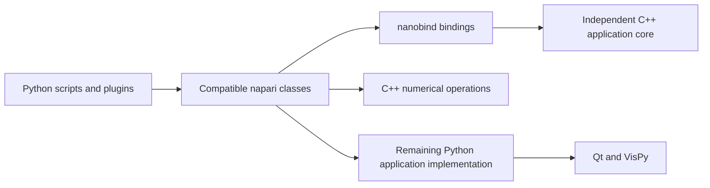

# Application migration

The baseline is napari 0.9.2, tag `v0.9.2`, commit
`595639295a153c84bcb127a9e07d801355440a35`, verified against GitHub and PyPI
on October 9, 2026. The latest-release endpoint still identifies 0.9.2 on
October 10, 2026. [Upstream release](https://github.com/napari/napari/releases/tag/v0.9.2).

The goal is to replace napari application implementation with C++, retaining
Python access through nanobind and compatibility with scripts/plugins. The
project now owns the napari source under `src/napari` and the builtin plugin
under `src/napari_builtins`. It builds a `napari` distribution with local version
`0.9.2+naparixx.2`, so plugin dependency resolution uses the correct package
identity. Runtime dependencies and GUI extras follow the baseline.

The latest [installed native owner](validation.md#shape-model-state-and-control)
moves the seven-class Shape model family's59 algorithms and canonical namespace
policy into handwritten C++17/nanobind while preserving Python API metadata,
actual dict/array/cache aliases, ABC and genuine deferred super.

The constrained Qt6 build passed with1137 held inputs. Installed verification
has **184passes, zero failures/errors/skips** across six terminal jobs;
baseline evidence has **138 logical passes**. The
[checkpoint](../.artifacts/viewer-shape-model-checkpoint.json) indexes exact
sources, binaries, commands, reviews and preserved failures. Ledger480 contains
25 reviewed facade/adapter helpers and455 partial records; nine dependency
operations are declared. Counts do not establish a completion percentage.
Earlier checkpoints retain their historical finite evidence.

Next: required Shape geometry/triangulation/dispatch/acceleration/raster helpers.
Import frame handling is verified only forCPython3.12; other required profiles
and full frame/reflection transport remain owned open work. Remaining Viewer/
Qt/model/task authority, queued-after-detach and clean shutdown remain open.
AllM0-M9 and final API/plugin/provider/platform/distribution/numerical/image/
performance/lifetime/thread/cancellation/GPU/audit/release gates remain required.
**Full conversion is incomplete.**

## Layer slice publication and native namespace checkpoint

The latest installed packet moves 17 complete operation bodies in eight facades
into `cpp/layer_publication.cpp`, `cpp/layer_thumbnails.cpp` and
`cpp/intensity_validation.cpp`. C++ owns Layer loaded/thumbnail publication,
Image/Labels thumbnails, Image and intensity contrast properties, uint8 conversion,
ordinary colormap mapping, sequence/increasing validation and float formatting.
Public signatures, properties, decorators and reviewed named binding lifetimes
remain. Returned validators retain the genuine nested function and its fresh
`n`/`dtype` cells; native code owns the validation algorithm. Pairwise returns the
actual declared `zip` primitive. Native comparison-iterator generator/frame/type
reflection remains an explicit M0 compatibility gap.

`LayerNamespaceBase` now owns the single canonical live heap dictionary and
weakrefs beneath actual `Layer` and `_LayerSlicingState`, reusing the sole existing
native `LayerLoadState` without another registry or snapshot. Installed finite
checks cover all seven actual layer constructors, aliases/replacement/mutation,
descriptors, cooperative inheritance, copying/restoration, weakrefs and GC.
Namespace ownership does not complete Layer/Pydantic semantic state authority or
arbitrary plugin inheritance. Six native call-local carriers retain only the
reviewed original assigned references.

The unchanged pre-port baseline passed 55 paired and 61 original cases. Installed
acceptance passed 527 cases with one existing optional real-typed-container skip
across nine jobs; every frontend reached actual terminal exit 0. Counts overlap.
The Windows profile is CPython 3.12.8/NumPy 2.5.3/PyQt6 6.11.0 with matching Qt
runtime/SDK 6.11.2. The final cohort records 740 runtime, 50 original and 108
preserved inputs. Receipt:
[layer-slice-publication-checkpoint.json](../.artifacts/layer-slice-publication-checkpoint.json),
SHA256 `10f97b1886db7074c811d8b6cc5b89fa46c00f8c9bd03cb9823614f3970c0c1a`.
It links the exact eight-facade boundary, source/profile/binary hashes and all
terminal/log/XML evidence. [Validation](validation.md#layer-slice-publication-and-native-namespace-checkpoint)
records the job breakdown.

The first editable build compiled/linked native C++ and Qt, then failed during
scikit-build-core 1.1.1 script packaging. A constrained 0.12.2 rebuild/reinstall
succeeded. The failed receipt/log and the creation-time packaging review remain
intact; the staging-directory disappearance is unexplained. This workaround does
not validate the full fresh-wheel matrix. Original/Base processes retain
138 instances/six types/97 functions; visual/workflow/GUI retain 144/six/97.
`clean_shutdown_proven=false`. The earlier Windows WMI diagnostic, raw before-images
and every historical failed report remain preserved.

The next proposed stage is native Image constructor core with reviewed interop:
12 complete bodies, with exact ownership in the
[current task card](full-conversion-plan.md#current-task-card-actual-viewer-async-slice-delivery).
Actual construction/first-refresh closure remains OPEN, including `Layer.refresh`,
`_clear_extent`, slice selection/request construction and owned initializers,
configuration, dtype/level and helper dependencies. Remaining model/Pydantic/transform/collection
authority, provider/worker/edit/history control, Qt/visual/GPU workflows, application
services and real plugins still require conversion and evidence. PartSeg/full Numba
typing/identity, TensorStore, private generator/frame/reflection, the supported
Python/OS/Qt/GPU matrix, fresh wheels, full upstream fixtures, workloads and all
M0-M9 gates remain open. `complete_application_port=false`; no percentage or
completed Viewer workflow is claimed. Earlier checkpoints retain creation-time scope.

## Image and native visual provider checkpoint

The preceding installed packet converted 35 whole Image/Tiled/visual/helper
bodies plus Volume import-time shader assembly in `cpp/vispy_image_layer.cpp` and
`cpp/vispy_image_visuals.cpp`. It covers both ImageLayerNode bodies, all 12
VispyImageLayer operations, eight TiledImageNode bodies and `make_tiles`,
TextureMixin construction/texture-format lookup, Image/Label bounds and label
color transforms, Volume construction/properties, `get_gl_extensions` and
`_napari_cmap_to_vispy`. Enum/shader literals and public metadata remain in the
facades; selected application decisions and call order are native.

One native `VispyNamespaceBase` dictionary owns actual TextureMixin/Tiled state
within finite saved/live-dictionary, Frozen/generated-node, weakref and GC
contracts. Inherited Base/Scalar controller dictionaries retain their accepted
native authority. Full semantic model/color/transform state, arbitrary providers,
plugin inheritance and GUI/GPU lifetime closure remain open.

That editable Windows CPython 3.12/PyQt6 Qt6 packet passed 411 cases with one
existing optional skip across seven terminal-exit-0 jobs, using 736 runtime,
39 original and 78 preserved inputs. It included 48 frozen paired comparisons
and 55 unchanged original visual workflows. Receipt:
[vispy-image-visual-checkpoint.json](../.artifacts/vispy-image-visual-checkpoint.json),
SHA256 `bea656a55bd8bde075d88239b8a0a1d1dc00b49c2b2bf68e321fb2f59edacdab`.
Counts overlap with later checks. The initial setup/NameError and metadata failures,
raw tests/logs/XML and corrected baseline remain immutable. Source review records
the Volume border lookup/release correction. The 144/six/97 visual and 138/six/97
Base shutdown cohorts remain open. The Layer publication checkpoint above adds
thumbnail/contrast/helper progress without completing modules, owned dependencies,
Viewer workflows or any M0-M9 release gate.

## Native Base and controller namespace checkpoint

All20 BaseLayer operations, the owned disconnect-events loop and two Scalar node
abstract exception bodies now dispatch to handwritten C++. `VispyNamespaceBase`
retains the canonical live controller/node dictionary and weakrefs beneath Base
and Scalar classes. The finite checks preserve dictionary aliases/replacement,
ABC/Generic cooperation, actual weak named callbacks, partial publication and GC.
The native units iterator and24-field call-local owner preserve the selected
operation lifetimes. Model/transform/visual provider closure remains required.

Independent source/facade/common reviews, exact additive stub reversal and the
editable CPython3.12/PyQt6 Qt6 rebuild passed. The five installed jobs exited0:
34 paired namespace/Base cases,202 accepted dependencies with one optional skip,
23 unchanged original Image/Labels/Canvas,39 async and10 paired GUI. Assertions
and original fixtures are unchanged. The308passes/one skip overlap. The receipt is
`.artifacts/vispy-base-controller-checkpoint.json`, SHA256
`744ba93c677080e9d3e82da7bd8bef929ce917409c8cb1c2b5078ec4e3e7bf7a`, covering
733 runtime/25 original inputs and the rebuilt native/Qt binary pair.

The original23 batch retains138-instance/six-type/97-function shutdown leaks;
async/GUI retain144/six/97, matching their separate baselines. The paired job
logged Windows`0x8007000e` in CPython WMI during flexcache/Pint import before
passing34 cases and exiting0. Its cause remains unresolved and the log is
preserved. No clean lifetime/environment or release claim follows from these passes.
Only eight prior stub-reference digests were refreshed; their classifications,
coverage, calls and evidence remain unchanged. All prior receipts/failures stay
immutable. Native visual inheritance/Frozen cooperation and the35-body Image/
Labels provider/helper/shader packet are next; existing facades remain held until
the finite pre-port baseline passes. Full plugins/providers, responsibility audit,
GPU/platform/fresh wheels/full upstream/workloads and all M0-M9 gates remain OPEN.
`complete_application_port=false`. Earlier sections retain creation-time scope.

## Complete native Vispy operations checkpoint

C++ now owns the selected Labels/scalar/GL application branches and call order,
including construction, display/upload/downsample/reset and dtype conversion.
The four accepted colormap prerequisites remain unchanged. Twenty additional
native entrypoints consolidate the stages; a 21-field Labels call-local owner
and ten added scalar/texture fields preserve local lifetimes with GC visibility.
They do not establish persistent controller state authority.

The fresh editable CPython 3.12/PyQt6 Qt6 build and all seven installed jobs pass
against 729 runtime and 22 original inputs: 202 native/control passes with one
optional skip, 25 unchanged original controllers including NumPy paint/fill/mouse,
33 main maps, 67 real Numba maps/large Labels, 19 original Labels/Vispy passes
with one optional skip, 39 async passes and ten paired GUI passes. Each subprocess
exited 0. Counts overlap. The assertions and original fixtures are unchanged.
Receipt: `.artifacts/vispy-complete-operations-checkpoint.json`, SHA256
`b7e98af30cf4ae236fbd7e85a0321170950624f8872886f00a964fe98f0dbcce`.

Independent native/facade reviews and exact additive stub reversal pass. The
stub proof preserves all old declarations and shared CMake/module/header bytes;
it refreshes only eight stale stub references in existing review records, without
changing their claims or classifications. Previous staged and failed evidence
remains immutable. Three original-controller/async/GUI jobs still report the known
144-instance/six-type/97-function shutdown leaks. Clean release is unproved.

Next is the canonical native controller namespace, complete BaseLayer operations
and the owned disconnect-events loop, with finite sourced dictionary, ABC/subclass,
callback and GC comparisons before facade edits. Owned visual/model/provider
callees, real plugins, the GPU/platform matrix, fresh wheels, full upstream suite,
workloads and all M0-M9 final gates remain open. `complete_application_port=false`.
Earlier checkpoint sections retain their creation-time scope.

## Vispy texture controller checkpoint

The 35 selected Labels/scalar/GL bodies and colormap prerequisites have installed
handwritten C++ implementations in `cpp/vispy_labels.cpp`,
`cpp/vispy_scalar_field.cpp` and `cpp/vispy_texture_services.cpp`. The facades
still contain staged application predicates/sequencing. Complete native control,
authoritative state and owned dependency closure remain required.

The frozen34 pre-port comparisons and editable CPython3.12/PyQt6 Qt6 build passed.
The final 728-runtime/22-original-input checks passed: 202 native/control cases
with one optional skip; 25 unchanged original controllers including real NumPy
paint/fill/mouse; 33 main maps; 67 real Numba maps/large Labels; 19 original
Labels/Vispy with one optional skip; 39 async; ten paired GUI. All seven final
subprocesses exited0. Counts overlap. Receipt:
`.artifacts/vispy-texture-controllers-checkpoint.json`, SHA256
`50d484ecec4efceb258e22b8b035a3006c0f21f50463d238fbf910b958b7fd43`.

The first installed run found two wrong native-extension imports. Only those
imports changed from `napari` to `naparixx`; raw failed sources/reports remain.
The first original batch required its actual pinned Vispy test namespace; a new
launcher mounts that test-only namespace without changing application paths,
original fixtures, assertions or the old launcher. The installed C++ build and
six unaffected passing jobs were reused. Independent source review corrected
weakref clearing before OpenGL finalization. Exact additive common-file review
updated only14 implementation references across eight existing records; claims,
classifications, evidence and69 other references are unchanged.

Original controller, async and GUI processes still report144 instances/six types/
97 functions leaked. Clean shutdown, full driver/platform/provider/reflection,
plugin/fresh-wheel/workload/full-original-fixture gates and all M0-M9 remain OPEN.
The big-3D pass does not separately capture its driver-capacity conditional branch.
`complete_application_port=false`. Next: complete native operation control and
BaseLayer/controller state ownership against the existing frozen contracts.
Earlier checkpoint narratives retain their creation-time scope.

## Label colormap map checkpoint

Eight Base/Cyclic/Direct map and shared RGBA-cache bodies now execute handwritten
C++ in `cpp/label_colormap_map.cpp`. Exactly eight facades preserve signatures,
named locals, cache/color aliases, selection, scalar/default and publication
order; a GC-visible native owner retains original `idx`/`value` loop references.
Constructors/validators, native state authority and wider module closure remain
open. Receipt: `.artifacts/label-colormap-map-checkpoint.json`.

The 25-case pre-port baseline and final 719-runtime/16-original-input inventory
are frozen. The editable CPython3.12/PyQt6 build uses Qt6 ON/Qt5 OFF and SDK/runtime
6.11.2. All seven finite jobs exit 0: installed build; 168 native/control passes
with one missing-Numba skip; 33 unchanged original main map passes; 67 real Numba
map/large-Labels passes; 19 original Labels/Vispy passes with one optional skip;
39 original async passes; ten actual paired GUI passes. Fork runtime paths are
verified. Async and GUI retain the known 144-instance/six-type/97-function leaks;
clean release is unproved.

The first regular-wheel build/pass and original launcher import-path rejection
are retained. Only install mode changed; sources, expectations and launcher did
not. Exact additive reversal proves one TU/hook/declaration and one stub class/
34 functions. Fourteen references in eight old reviews are refreshed; 69 others,
classifications and JUnit claims stay unchanged. This proof is static evidence.

Next: 35 Labels/scalar/GL controller bodies with four colormap prerequisites,
after their frozen 34-case baseline. Real GPU, constructor/validation, provider/
reflection/Numba/PartSeg, clean close, source/foundation, full fixture/plugin/
fresh-wheel/platform/workload acceptance and all M0–M9 remain open.
`complete_application_port=false`. Earlier checkpoint sections are historical.

## Direct colormap cache checkpoint

Eight Direct/Base cache construction and invalidation bodies now execute
handwritten C++ in `cpp/direct_colormap_cache.cpp`. Original cached properties
and private cache dictionaries remain shared by identity. Native code preserves
color-array aliases, insertion/cast order, selection routing, lazy typed imports,
fresh cache replacement and partial publication. Two GC-visible native classes
retain only the suspended iterator and original named loop references.

The final installed build passes143 main comparisons/controls and45 real Numba
cache/reload cases. Unchanged originals pass9 main cache cases with6 optional
skips,30 real Numba cache cases,6 Labels/Vispy cases with1 optional skip and the
same large-label case in its real Numba supplement. Async39 and paired GUI10
pass with the known144-instance/six-type/97-function shutdown leaks. Counts
overlap. Initial passing reports precede one native temporary-release-order
correction; final V2 reports verify that corrected source with unchanged tests.

The receipt is `.artifacts/direct-colormap-cache-checkpoint.json`. All M0–M9
remain open. Next: eight Base/Cyclic/Direct map and RGBA-cache bodies, followed
by deepcopy, Vispy upload, thumbnail publication and other owned dependencies.
Full reflection/provider/Numba/PartSeg, lifetime and release acceptance remain
required. Earlier checkpoint sections retain their historical scope.

## Accelerated colormap checkpoint

Twelve concrete `_accelerated_cmap.py` definitions, backend alias/initialization
control and both formerly JIT-compiled owned loops now use handwritten C++ in
`cpp/colormap_acceleration.cpp` and `cpp/colormap_inner_loops.cpp`. Thin facades
retain signatures and meaningful local references. Native mode dispatchers keep
old plain/compiled aliases stable across actual reloads and expose exact
`.py_func` metadata; namespace and cache objects retain their existing authority.

The main installed build passes 107 directed/Labels/controller, 25 original
Labels/Vispy, 35 original colormap, 39 async and 10 paired GUI cases. The isolated
real Numba overlay passes eight dispatcher/reload/GC and 88 original colormap cases;
all 96 arithmetic comparisons match 48 frozen original rows. Counts overlap.
Two real PartSeg cases remain skipped. Async/GUI exits still report 144-instance,
six-type and 97-function leaks. Full typing/CPUDispatcher identity, real PartSeg,
provider/platform and responsibility/workflow/release contracts remain open.

The receipt is `.artifacts/colormap-acceleration-checkpoint.json`. All M0–M9 are
open. Next: eight Direct/Base cache construction/invalidation bodies, followed
by mapping, Vispy upload, thumbnail publication and remaining owned dependencies.
Earlier sections below retain their historical scope.

## Labels display and texture checkpoint

Eleven selected definitions now use handwritten C++ in `cpp/labels_display.cpp`
and `cpp/label_colormap.cpp`: Labels raw/contour/dtype routing, contour morphology
and slice expansion, Cyclic/Direct texture routing, unsigned views, auto/direct
casts and texture dtype selection. Thin facades retain original named locals and
direct `data` rebinding. SciPy morphology and NumPy operations remain external
primitives; owned accelerated mapping, colormap/cache construction, thumbnails,
base publication and Vispy upload still require conversion.

The pinned baseline passes 34 cases. The installed main build passes 67
native/controller cases, 25 unchanged Labels/Vispy cases, 35 unchanged texture
cases with eight missing-numba skips, 39 original async cases and 10 real paired
GUI cases. Counts overlap. Async/GUI fixture exits still emit 144-instance,
six-type and 97-function leaks. Preserve the original baseline fixture errors
and GUI invocation errors; corrections retain application expectations and
original inputs. The scoped receipt is `.artifacts/labels-display-checkpoint.json`.
All M0–M9 remain open; no full Labels/Viewer workflow or release parity is claimed.

The next packet is the twelve concrete `_accelerated_cmap.py` bodies, including
both owned Numba inner loops and backend alias/reload control. Remove JIT of
owned application algorithms and implement them by hand. Shared cache objects,
optional dependency primitives and backend behavior must retain their contracts.

## Image contrast and Viewer delivery checkpoint

Fourteen Image/range/dtype/coercion/reset definitions and the range adapter now
use handwritten C++ in `cpp/range.cpp` and `cpp/slicing_bindings.cpp`. Python
retains thin signatures, metadata and required local captures/rebindings. Generic
provider slicing, NumPy reductions and Dask execution preserve the pinned
sampling/materialization contracts; existing typed range overloads remain intact.
Eight preceding Viewer/Layer/scalar/Image delivery controls also run in C++.
The required Labels/thumbnail/base/Vispy algorithms remain incomplete.

The main installed build passes 166 directed/range/controller cases, including
41 independently sourced contrast comparisons, 30 unchanged original contrast/
Image cases with one missing-tensorstore module skip, 39 unchanged async workflow
cases and 10 paired native/pinned real GUI cases. Counts overlap. The last two
processes still emit 144-instance/six-type/97-function nanobind leaks. The bounded
receipt is `.artifacts/image-contrast-checkpoint.json`; no clean fixture exit,
whole-class, full Viewer workflow or M0–M9 completion is claimed. Shadowed
generator-consuming builtin behavior and full provider/release evidence remain
open. Named partial declarations are in `migration.json`; source/dependency
review closure remains required.

## Grid dictionary publication checkpoint

The bounded Grid map-publication repair is accepted in four selected installed
Windows development environments. Handwritten `cpp/component_state.cpp` installs
Grid's physical `__dict__` getset and shares staged successor publication with
Camera. GridState/core identity and wide-integer/provider decoding remain the
same. Obsolete internal references are released before return; saved caller
maps/views/records retain passive aliases. Internal native backlink stores bypass
subtype hooks, while caller assignment and finalizer timing preserve the tested
contracts. Provider pinning, pause cleanup and retired-conversion protection
continue through the shared native path.

Grid23 passes: 16 unchanged pinned comparisons plus seven native diagnostics.
The original Grid17 byte prefix and 12-pass/five-fail report remain immutable;
all five actual failures now pass. Focused regressions pass 851; selected
main/CP311/PyQt5/PySide6 cases pass 2,600/2,452/2,485/2,485, with separate CP311
shutdown 22. Unchanged selected upstream tests pass 1,119 with the original three
tensorstore skips and two mouse-coordinate deselections. Eight normal/exhausted
cold processes pass 13 Grid, retained 13 Camera and inherited ownership checks.
Counts overlap. The matrix verifies 710 runtime/test/helper inputs, 34 upstream
inputs, 61 prior reports and seven installed binaries. Main/Side SDK/runtime is
Qt 6.11.2; Qt5 is 5.15.2; CP311 native Qt bridges remain OFF. Builds/GUI jobs were
serial. Four historical C++ core passes reuse 16 unchanged inputs; they do not
cover the new CPython descriptor.

Canonical evidence: `.artifacts/grid-namespace-checkpoint.json`, with
`.artifacts/grid-namespace-matrix-receipt.json`, bounded native/publication and
stub review, original failed reports and final checks. Eight existing review
objects were refreshed only for the inspected additive stub and fresh named-case
evidence. Their bodies/calls/responsibility claims are unchanged; no Grid class,
method/module or milestone review was added. Source audit remains incomplete:
13 reviewed, 6,716 unreviewed, zero invalid reviews/issues.

Saved BaseModel descriptor bypass, eager Grid.model_copy provider consumption,
foreign keys/malformed private metadata and wider provider/subclass/reflection,
interpreter/worker/authority contracts remain OPEN. The oracle shares installed
Pydantic/event services; original discovery preserves its WMI import diagnostic.
Selected editable evidence does not close full fixtures/plugins/providers,
fresh wheels or the Python/OS/architecture/GPU/workload matrix. All M0–M9 remain
OPEN and the full completion flag remains false. The next implementation is
actual Viewer async slice delivery and its required Image/Labels response owners.

## Earlier Camera dictionary publication checkpoint

The bounded Camera field-map publication packet is verified against four
selected installed Windows development environments. Handwritten
`cpp/component_state.cpp` installs Camera's native `__dict__` descriptor and
publishes successor records before releasing obsolete internal map references.
The same CameraState/core remains authoritative; saved caller maps, views and
old native records retain their explicit aliases without controlling the current
state. Private-map controls continue through the existing native model owner.

Successors, watcher rows and native backlink storage are staged before physical
publication. Internal backlink writes use the actual native attribute dictionary
without invoking subtype assignment hooks; ordinary caller writes still honor
those hooks. Provider inputs, owners and records stay pinned across callbacks;
retired conversions do not overwrite successors, and guard cleanup releases the
current same-owner pause. These are bounded ownership/control guarantees, not
whole-Camera conversion or general allocation-failure proof.

The 20 directed cases pass: 13 unchanged pinned Camera/EventedModel comparisons
and seven native ownership/reentry/hook cases. The original 14-case pre-port
report remains nine passed/five failed; its original assertions are unchanged.
Focused regressions pass 626; main/CPython 3.11/PyQt5/PySide6 selectors pass
2,577/2,429/2,462/2,462, with a separate 22-pass CPython 3.11 shutdown suite.
Selected unchanged upstream cases pass 1,119 with three original tensorstore
skips and two original mouse-coordinate deselections. All eight cold processes
pass 13 Camera checks plus inherited ownership checks in normal/exhausted modes;
CPython 3.11 uses fallback and has native Qt bridges OFF. Counts overlap.

The canonical receipt is `.artifacts/camera-namespace-checkpoint.json`, linking
the 707-input matrix, seven installed binaries, original evidence, bounded
ownership review and source audit. Eight existing review objects were refreshed
only for the inspected one-line native stub addition and unchanged reviewed
bodies, registrations and dependency calls. No Camera class/method/module review
or milestone completion was added. The four historical C++ core passes are
reused for 16 unchanged inputs; they do not cover the new CPython descriptor.

Saved BaseModel descriptor setter bypass, foreign colliding keys, malformed
private metadata and wider provider/subclass/copy/worker contracts remain OPEN.
The pinned-body oracle shares installed Pydantic/event services. Full original
fixtures/plugins/providers, fresh wheels, Python 3.13/3.14 and the declared
OS/architecture/GPU/workload gates remain open; all M0–M9 stay OPEN and the
completion flag is false.

At the Camera checkpoint, Grid dictionary publication was the next packet.
Its prepared17 tests/discovery were excluded from Camera runtime acceptance.
The later Grid checkpoint above preserves the actual pre-port failures and
bounded repair; the original WMI diagnostic remains historical.

## Dims namespace publication checkpoint

The bounded Dims implementation-metadata and dictionary-publication packet is
verified against selected installed Windows builds. Handwritten
`cpp/dims_namespace_owner.cpp` retains eight implementation references in native
fields, with explicit GC traversal/clearing and a read-only `_native_storage`
descriptor. It coordinates field/projection and private flag-record publication
with the existing native private-map owner. The physical BaseModel dictionary
remains the exact supplied object used by Pydantic and ordinary field access.

Generic replacement/deletion releases obsolete internal map/projection edges
before returning, after publishing the new state for payload finalizers.
Explicit saved maps, records and views preserve their tested aliases. Trusted
copy, construct and restoration paths store external providers without the
extra iteration or swallowed errors reproduced before this packet. The original
22-case report (two passed, 20 failed) is preserved. All 27 final directed cases
pass, including five added GC/subtype/finalizer checks; unchanged pinned Dims
and EventedModel bodies supply 23 comparisons, with four native-owner checks.
The oracle shares installed Pydantic/event services.

Fresh sequential affected selectors pass 2,557 main, 2,409 CPython 3.11 and
2,442 each PyQt5/PySide6 cases; separate CPython 3.11 shutdown passes 22.
The focused selector passes 530. Selected unchanged upstream cases pass 1,119
with three existing tensorstore skips and two existing mouse deselections.
Eight cold probes pass, exercising normal/exhausted watchers and Python 3.11
fallback; its native Qt bridges remain OFF. Counts overlap and must not be added.

PySide6 cold bridge import initially failed because the QApp-free helper had
not preloaded QtWidgets DLLs. A controlled probe confirms that importing the
module resolves the same bridge's import while `QApplication.instance()` stays
None. The original failure/helper and new Side-only helper are preserved. Six
cold passes use the original helper; two Side passes use the corrected helper.
No application runtime change was needed for that import correction.

The canonical receipt is `.artifacts/dims-namespace-checkpoint.json`, linking
the matrix, cold, boundary-review and audit evidence. Eight existing bounded
reviews were refreshed only for the inspected additive stub/CMake edits; their
reviewed bodies, targets, registrations and calls are unchanged. There are still
13 valid reviews and 6,716 unreviewed responsibilities. Direct native Dims
ownership/getset/export review is recorded separately; no new whole-Dims class,
child-method or module review is claimed. The four older pure C++ reports are
reused only for unchanged core inputs and do not cover the new CPython owner.

The saved BaseModel dictionary-descriptor setter bypass, `_native_state`
diagnostic provider conversion and wider private/provider/reflection contracts
remain OPEN. The bypass preserves the physical dictionary but does not prove
synchronous native record/projection publication. Full original fixtures,
plugins, fresh wheels, Python 3.13/3.14 and the required OS/architecture/GPU and
workload matrix remain open. All M0–M9 remain OPEN and the completion flag is false.

At this checkpoint, the next packet was Camera dictionary publication. The finite
`.artifacts/camera-namespace-pre-port-discovery.json` compares six raw-map
lifetime cases and finds three mismatches: field-map replacement, deletion and
release after a caller drops its saved old-map alias. All three private-map
controls match. These are next-packet failures, excluded from the accepted Dims
selectors; native reads or later collection must not conceal delayed release.
The new 14-case pre-port suite passes nine and fails five, with zero errors/skips:
four field publication/alias failures and one saved-native-record retention
failure. Its unchanged pinned Camera/EventedModel controls pass; the original
report is `.artifacts/camera-namespace-pre-port-receipt.json`.

## EventEmitter namespace authority checkpoint

The bounded EventEmitter namespace packet is accepted. Handwritten
`cpp/event_state_owner.cpp` supplies a GC-visible CPython heap base exported
through nanobind. EventEmitter, EmitterGroup and inherited warning emitters
retain their exact instance dictionary in that native base. The dictionary
contains the canonical callback/reference/pass-event lists and all other emitter
state; no parallel native subscription cache overrides it. Existing handwritten
C++ subscription and delivery control continues to read the live attributes.
Raw dictionary edits, exact dictionary replacement and deletion therefore reach
the same state used by connect, disconnect and emission.

Native traversal visits the dictionary and actual heap type exactly once,
without a strong weak-reference edge. Tested replacement/deletion finalizers,
subtype resurrection, uninitialized/slotted instances, callback/type cycles,
default reduction, shallow/deep copies and pickle reconstruction preserve the
pinned contracts. The focused selector passes 128 cases: 37 namespace cases
(32 pinned comparisons and five direct native-owner checks) plus 91 existing
event-engine comparisons. Fresh sequential selectors pass 2,530 main, 2,382
CPython 3.11, 2,415 PyQt5 and 2,415 PySide6 cases. Separate CPython 3.11 shutdown
checks pass 22; the established upstream subset passes 1,119 with three existing
tensorstore skips and two existing mouse-fixture deselections. Eight cold
installed probes pass. These overlapping counts are not a combined suite.

The source/binary/test checkpoint is `.artifacts/emitter-namespace-checkpoint.json`;
exact commands and final hashes are in `.artifacts/emitter-namespace-matrix-receipt.json`
and `.artifacts/emitter-namespace-cold-receipt.json`. The
[validation checkpoint](validation.md#eventemitter-namespace-authority-checkpoint)
records the evidence and limits. No Python-independent core check covers this
CPython object-ownership contract.

The source audit records 13 valid bounded reviews, 6,716 unreviewed
responsibilities, zero invalid records/issues, 6,155 definitions, 34 declared
partial modules and 39 modules with native evidence. Two class-shell namespace
reviews were added; six unchanged definition reviews were revalidated in
`.artifacts/emitter-namespace-boundary-review.json`. The class-shell reviews do
not accept separately inventoried child methods or the whole event module.
Native type creation/export was reviewed directly: the hash-schema checker does
not parse `PyType_FromSpec` or resolve nanobind `module.attr` exports.

Observable layout differences remain OPEN M0 compatibility questions. The native
base adds an MRO entry; on the directed CPython 3.12 check, the native instance
size/dictionary/weakref offsets are 32/16/24 versus the baseline 16/-1/-32.
Assignment to an unrelated ordinary Python class raises TypeError natively while
the baseline accepts it; reassignment within the emitter hierarchy succeeds in
both. `.artifacts/emitter-namespace-layout-questions.json` records these results.
No full plugin/private-reflection parity is claimed. The four observed Windows
environment locks in `.artifacts/m0-installed-interop-lock-evidence.json` are
inventory evidence, not frozen M0 acceptance locks. All M0–M9 remain OPEN and
`complete_application_port=false`.

At this earlier checkpoint, the next bounded packet was Dims dictionary authority
across watcher and fallback modes. Its new 22-case pre-port probe records two
passes and 20 failures, with no errors. Independently loaded unchanged pinned
Dims/EventedModel implementations satisfy all 19 baseline assertions; three
other cases target native-only ownership contracts. The observed gaps cover old
map retention/delayed finalizers, trusted custom-sequence iteration/errors/reentry
through copy/construct/restore/memo paths, and Python `_native_storage` metadata.
Evidence is `.artifacts/dims-namespace-pre-port-probe.xml`, its process log and
`.artifacts/dims-namespace-pre-port-receipt.json`. These next-packet failures are
excluded from the accepted EventEmitter selectors. Broader Event/blocker/tracing
state, provider/plugin contracts and full application/release gates remain open.

## Primary and delay-state authority checkpoint

This section preserves the earlier bounded primary/delay checkpoint. The
Dims checkpoint above is the current handoff.

The bounded primary and delay-state packet is accepted. A GC-visible native
owner retains the exact Pydantic private map through a real model slot. The
exact `_primary_changes` mapping and `_delay_check_semaphore` object in that map
are the sole application authorities; no independent primary-name or depth
store overrides them. Handwritten C++ owns capture/drain, comparison and
delayer arithmetic/context control while preserving the tested Python numeric
protocols, including wide integers and provider counters. Restored Pydantic
`PrivateAttr` metadata preserves the tested factories, descriptors and
copy/restore aliases. Arbitrary primary keys/values and live mapping views
retain the supplied objects.

Legacy journal diagnostics hold weak owner links without retaining application
payloads. The cold-GC/copy repair preserves the tested release and memo
boundaries. Deliberately supplying the same legacy journal in two private maps
still reports the first live owner's diagnostics; this is an explicit fork
limitation. Journal `.enter()`/`.leave()` remain standalone pure C++ helpers,
not the application's delay-state authority.

The source/binary/test-hashed receipt is
`.artifacts/primary-state-checkpoint.json`, with exact commands and frozen
matrix hashes in `.artifacts/primary-state-isolated-matrix-receipt.json`.
The final focused selector passes 345 cases, including 33 directed cases
(32 pinned comparisons and one owner-edge regression), nine diagnostics and
the 53 preserved transaction-owner cases. Fresh sequential selectors pass
2,484 main, 2,336 CPython 3.11, 2,369 PyQt5 and 2,369 PySide6 cases. The separate
CPython 3.11 shutdown suite passes 22; the established upstream subset passes
1,119 with three existing tensorstore skips and two existing mouse-event
deselections. Eight cold installed probes pass. Four pure C++ core checks reuse
prior passing reports with unchanged target sources; prior core executable
hashes were not recorded, and no new runtime coverage is claimed. These
overlapping counts are not a combined suite.

The initial main report remains 2,481 passed and three GUI subprocess failures
with status `0xC000070A`. The exact three cases then passed unchanged isolation,
and the fresh sequential main selector passed all 2,484. The original cause
remains unresolved; this evidence does not establish concurrency or release
parity. CPython 3.11 native Qt bridges remain OFF. See the current
[validation checkpoint](validation.md#primary-and-delay-state-authority-checkpoint)
for the preserved pre-final focused failures and limits.

The fresh `.artifacts/primary-state-responsibility-register.json` audit records
11 valid bounded reviews, 6,718 unreviewed responsibilities, zero invalid
records/issues, 6,155 definitions, 34 partial modules and 39 modules with
native-call evidence. Six unchanged bounded targets were revalidated in
`.artifacts/primary-state-boundary-review.json`; no new ownership responsibility
was accepted by that review. These counts do not establish behavioral parity.
All M0–M9 remain OPEN and `complete_application_port` remains false. Broader
provider/class-reflection and EventedModel/M1 contracts, full original fixtures,
plugins, fresh wheels and supported platform/GPU/workload gates remain open.

At this checkpoint, the next task was EventEmitter namespace authority. Its
original 29-case pre-port probe has 28 pinned passes and one native-base-absence
failure in
`.artifacts/emitter-namespace-pre-port-probe.xml` and its process log. M0
acceptance preparation proceeds independently. That probe remains historical;
the accepted bounded namespace packet is recorded above. No whole module or
milestone completion is claimed.

## Context namespace and Qt lifetime checkpoint

Three native context helpers now own the new PyType_GetDict reference and
retain the selected descriptor during binding. The exact focus callback
control runs in C++; a GC-visible native connection record retains the
exact callback and connection token through read-only views without a
direct application reference. The original window atexit worker loop now
forwards to native shutdown control. Shutdown disconnects napari's own
focus callback, queues napari's shared menu actions for deletion and drains
deferred callbacks twice. Other connected handlers retain their identities.

The Python 3.11 selector and supplemental Qt shutdown report are distinct
checks; their counts are not combined into a larger selector. PyQt6 is
installed for the actual Python/Qt GUI checks, while the Python 3.11
native extension was built with NAPARIXX_BUILD_QT and NAPARIXX_BUILD_QT5
both OFF. This does not establish Python 3.11 native Qt bridge or full
release-matrix parity.

The final reports and process logs contain zero failures/errors and no
nanobind leak diagnostics. The three skipped cases explicitly lack the
optional tensorstore provider; the two mouse-event cases retain the
existing upstream GUI-fixture deselection. Earlier failing shutdown
reports remain historical and are excluded from these passing counts.

11 bounded records remain valid; 6,718 responsibilities remain unreviewed, with no stale
records or review issues. Six existing records were refreshed only after
reconstructing the prior stub, registrations and three bounded context
helper edits and verifying the exact fresh named cases. New Qt focus,
connection and shutdown responsibilities remain unreviewed. The review
gate remains incomplete and does not establish behavioral parity.

The concrete type-namespace leak and Qt callback root are repaired in the
verified selected processes, including the exact original file-menu and
repeated Viewer reproductions. This evidence covers selected Windows
configurations. Broader model/collection/event state authority, Qt
controller ownership, provider/private contracts and full upstream,
plugin, wheel, OS, architecture and performance parity remain open.
All M0–M9 milestones remain open; M1 is incomplete.

The source-hashed checkpoint evidence is `.artifacts/context-lifetime-checkpoint.json`;
earlier iterator and root-trace artifacts retain their historical scope.

All earlier checkpoint sections describe their recorded source/binary
state; their totals and shutdown observations are historical evidence.

## Current boundary



Dimension, camera and grid facades retain their public Pydantic schemas and
napari events. Standard validated Dims fields now have one persistent C++ state
owner. To preserve the exact builtin `__dict__` contract, the physical Python
dictionary now retains the public field representations, including numeric
tuples. `cpp/dims_dictionary.cpp` observes direct writes with CPython dictionary
watchers and updates native primitive state without invoking Python code from
the watcher. Binding entries synchronize the dictionary when a watcher is
unavailable. This is an intermediate compatibility design: the authoritative
state exit still needs review, including Python 3.11, watcher-slot exhaustion,
low-level dictionary replacement and worker access. Dictionary watchers were
added in Python 3.12. [CPython dictionary API](https://docs.python.org/3.12/c-api/dict.html).
Native field access, normalization, assignment boundaries, copying and
serialization are implemented in `cpp/dims_model_bindings.cpp`. Native records
own shared C++ state and GC-traversed dictionary handles. Separate Python
adapter slots retain public wrappers and provider metadata; the independent
model core contains no Python references. Python descriptors
hold field-index metadata and forward the descriptor protocol to nanobind.

Pint units, plugin-added fields and explicitly unvalidated provider objects
remain GC-visible Python adapter values. Trusted `model_copy`/`model_construct`
and disabled assignment validation preserve their input identities. Camera and
Grid still retain independent Python fields and synchronized native snapshots.
Dims axis updates, reset, navigation and computed-property transitions now run
in handwritten C++. Deleted-field access, dependency-specific trusted values
and tested plugin schema overrides match the pinned implementation. Public field
value identity and independent restored native ownership now match the tested
baseline. Validation context transitions, exceptions and cleanup are C++; a
thin `yield from` adapter preserves Python generator/context/decorator protocols.
Its native iterator stores model/previous-value references in its GC-traversed
Python dictionary rather than in C++ state. Tested live dictionary behavior now
matches the baseline. Primitive playback/scroll/validation flag state and
validation truth decisions now run in C++; the private dictionary retains
compatible values and provider references. Models sharing a restored private
dictionary share its native flag owner, while ordinary copies own independent
flags. Plugin attribute hooks and non-primitive truth protocols remain adapters.
Broader dictionary/provider ownership and platform behavior remain open. This is a
partial M1 implementation, not a completed model conversion.

Computed-property event dependencies are declared explicitly: Python cannot
infer field dependencies by inspecting C++ function bodies. The GC-visible
native private-map owner retains the exact EventedModel primary mapping,
delay-counter object, queue and Python old-value representations. These exact
primary/counter objects are the application's state authorities. C++ bindings
perform assignment, comparison, emission and numeric/context-delayer decisions
with the GIL held; legacy journal links are weak diagnostics. EventEmitter's
exact instance dictionary and subscription lists now have one native heap-base
owner while remaining accessible to Python and GC. Handwritten
`cpp/model_helpers.cpp` now implements event initialization,
source resetting, defaults, nested reset/update, model equality and enum-context
transitions. `cpp/model_metadata.cpp` now owns class preparation after Pydantic
construction, inherited property/equality maps, encoder registration and explicit
or recursive property-dependency discovery. Python retains class construction,
schema/property metadata and field storage. EventEmitter/EmitterGroup and tracing
control now run in handwritten C++; callback/payload/blocking storage remains
visible to Python GC. Other Event/blocker/tracing state authority and broader
provider/reflection, ownership and lifetime review are still required.
No Python callbacks or references are stored in the independent C++ core.

Qt dimension widgets disconnect their model events and release facade references
when the viewer closes. Qt mode push buttons use weak layer references. Deferred
Qt destruction is flushed in lifecycle checks, which verify collection of
model facades, layers and their native states in 2D and 3D.

Camera view fitting, center/zoom calculations, rotated bounds and 2D/3D mode
decisions call native functions directly. Python applies their results through
public field setters to preserve event delivery and orchestration. The canvas
also delegates grid viewbox geometry to C++.

The independent core now also owns real matrix math, slice plans, layer loading
state, extent/step aggregation, scalar slice indices, multiscale tile geometry,
vector visibility and surface face remapping. Handwritten C++ bindings implement
the complete scalar, point, vector and surface slice request control flow and
layer-slicer scheduling decisions. The scheduler still uses Python executor,
future, lock, dictionary and event objects; these remain visible to Python's
garbage collector. Layer request construction and applying responses remain
part of the Python layer models.

Lazy arrays are indexed through their existing protocols and materialized only
for requested slices. Context managers receive the original exception and
traceback, including their exception-suppression behavior. Scheduling snapshots
one-shot layer iterators so task matching cannot consume them before dispatch.
Tests check actual Dask chunk reads, asynchronous cancellation/error behavior
and rejection of stale loading completions.

All transform utility function bodies are handwritten C++. Real double-precision
matrix algorithms run in the independent core; complex and dtype-sensitive
operations use NumPy/SciPy primitives at the binding boundary. Projection
reductions also use NumPy; Pint remains responsible for unit objects/registries.
These dependencies have not been rewritten. Transform construction, property
transitions, cache decisions, chain control and slice/expansion methods now also
forward to handwritten C++. Live NumPy arrays, cache dictionaries, units and
signal/callback references remain GC-visible Python storage. Typed/EventedList
control now runs in handwritten C++; nested/set/selection/selectable control
also has native implementations. Collection state authority, evented
dictionaries and other remaining container responsibilities are unfinished.

Numerical functions use decorators installed in their source definitions.
`enable()`/`disable()` change a dispatch flag, preserving function identities
and aliases cached before activation. Six numerical operations retain Python
fallbacks for unsupported data representations. Affine/ScaleTranslate coordinate
application and point slicing now use C++ in both dispatch modes. Other converted
application paths likewise have no original Python fallback. Differential tests
and benchmarks load the pinned upstream sources explicitly. Activation requires
the verified baseline and matching extension version.

`migration.json` identifies each migrated responsibility and its remaining
Python code. No complete application rewrite or module-count percentage is
claimed. The baseline inventory includes 556 non-test Python modules and
120,975 lines, including benchmarks and bundled helpers.

## Remaining implementation

Current installed finite evidence is 527 passes/one existing optional skip in
[layer-slice-publication-checkpoint.json](../.artifacts/layer-slice-publication-checkpoint.json).
The next packet is native Image constructor core with reviewed interop (12 core
operations). Actual construction/first-refresh and every owned initializer,
configuration/dtype/level/request/helper obligation remain explicitly OPEN.
Native canonical Layer/controller/selected visual dictionaries and accepted
operation bodies leave the broader responsibilities below open. Shutdown remains
unclean and every M0-M9 gate remains required.

| Area | Required C++ work | Acceptance evidence |
| --- | --- | --- |
| Layer state and collections | Remaining layer properties/storage, extent construction, collection mutation, selection, features and authoritative transform/cache state | Public attributes/types, validation, event order, serialization and representative plugin behavior |
| Slicing and editing | Layer request construction/application, remaining geometry, scalar response helpers, paint and undo/redo | Lazy IO, cancellation, immutable worker requests, editing parity and main-thread delivery |
| Application orchestration | Actions, settings, file IO and plugin dispatch | Existing commands, readers/writers, dock widgets, plugin callbacks and error reporting |
| GUI and rendering | C++ Qt controllers/widgets and rendering orchestration | Actual interactions, screenshots, keyboard/mouse flows and GPU resource ownership |
| Releases | Wheels, upstream updates and platform support | Full upstream suite, representative real plugins and Windows/Linux/macOS validation |

Python remains necessary to run Python plugins. Their callbacks require the
GIL and Python object ownership. The C++ core should remain independent of the
interpreter; bindings/adapters own those dependencies. Public Python classes
must preserve the attributes/events expected by plugins even when their
implementation moves into C++.

## Full conversion plan

This plan was audited against native version 0.3.0 and the pinned 0.9.2 sources.
It is planned work, not a statement that these milestones have been completed.
The scope is all napari-owned application implementation, written by hand in
C++. Python remains for public API facades, Python plugins and explicit external
dependency adapters. The interpreter and third-party packages are not themselves
being rewritten. Keep the baseline fixed during migration; reconcile newer
napari releases separately after parity has been established.

### Gaps confirmed in the source

Selected responsibilities in thirty-two declared source files call native implementations;
these are not thirty-two fully converted modules. The upstream inventory contains
556 non-test Python files, including benchmarks and bundled helpers. Another
ten files implement the builtin plugin. Both packages are in the conversion
scope. File totals do not provide a meaningful conversion percentage.

| Gap | Evidence in this fork | Work still required |
| --- | --- | --- |
| Authoritative model state | Dims has native field and primitive flag owners with dictionary observers; fallback/alias/provider ownership remains open; Camera/Grid retain Python fields and native snapshots; EventedModel class preparation/dependency discovery and exact private-map/primary/counter ownership are native for the tested contract, while other field storage/public metadata references remain Python; most Layer fields still live in Python | Establish one native authority across the supported contract, then move all model state, transitions, cache invalidation and event decisions into C++; facades expose compatible views |
| Collections and transforms | LayerList, transforms and all eight typed/evented/nested/set/selection/selectable/dictionary container implementation modules forward their owned control to C++; arrays/cache/list/set/dictionary/selection authority remains partial | Complete authoritative LayerList/collection/transform/cache state and dependent services, with the broader provider/private contracts |
| Slice lifecycle and editing | `layers/_scalar_field/scalar_field.py` constructs requests and applies results in Python; Labels paint/fill/history and Points edits remain Python | Convert the entire data-to-request-to-result-to-edit lifecycle |
| Remaining layers | Shapes and Tracks models, geometry, interaction and view slicing remain Python | Complete these layers along with the remaining Image/Labels/Points/Vectors/Surface models |
| Dependency-heavy bindings | `cpp/layer_bindings.cpp` invokes NumPy/SciPy/Pint; `cpp/slicing_bindings.cpp` constructs Python responses; `cpp/orchestration.cpp` uses Python futures/locks/executors | Separate allowed dependency calls from application algorithms and move owned state/scheduling/math into the native core |
| GUI | The inventory has 195 `_qt` modules; an optional native Qt host is tested with PyQt5, PyQt6 and PySide6, while the Viewer uses Python controllers | Implement native Qt controllers/widgets, window management and interaction, with compatible plugin-widget bridges |
| Rendering | The inventory has 55 `_vispy` modules | Port napari scene/visual orchestration, transforms, picking and resource decisions; define the rendering dependency boundary |
| Application services | Actions, context expressions, settings, IO, plugin coordination, CLI/startup and supporting utilities remain Python | Native service implementations with explicit Python extension adapters |
| Compatibility and validation | The dictionary checkpoint covers Windows/CPython 3.12 and 1,667 headless checks on CPython 3.11; broader GUI-loaded selectors retain native state; the fork's CI matrix omits Python 3.14, Qt variants and upstream's Linux ARM64 coverage | Resolve shutdown retention; full upstream fixtures, feature/API/platform checks, numeric edge cases, real plugin workflows and packaging validation |

### Current Dims record ownership and field-view checkpoint

Both Dims records own their observed dictionaries in native `nb::object` fields
with explicit GC traversal and clearing. Their reference views are read-only,
and mutable instance dictionaries are removed. Observer/registry links are
detached before releasing payloads; their shared C++ state owners remain native.
Field dictionary adoption also replaces the adapter's cached current mapping
view. External saved views keep their original dictionary and values until the
caller releases them. Reentry sees the new observer, fields and cache together.

The 25 new checks cover mutation attempts, direct GC edges, retained records,
cycles, uninitialized instances, field/private replacement finalizers, current
and saved views, shared restored dictionaries and active exceptions. Results
are 2,235 local passes, 1,115 selected unchanged upstream passes (three optional
tensorstore skips and six existing exclusions), 2,109 Python 3.11 headless
passes, 2,120 passes per PyQt5/PySide6 selector, 168 Dims ownership/state passes
and four Python-disabled C++/Qt CTests. Eight cold installed-binary probes check
normal and exhausted watcher modes across all four environments.

The first broad run retained two additional native types stored directly in
pytest parameters. The parameters now hold class names and resolve types inside
each test, preserving the assertions. Broad shutdown returns to the prior
48 journals, five types and 96 functions; the original production roots remain
unproven. Broader model authority/provider/worker/platform and dependency
contracts remain open. Eleven bounded reviews are valid, 6,717 responsibilities
remain unreviewed and all M0–M9 gates remain open. Fresh evidence is
`.artifacts/dims-owner-checkpoint.json`; see the
[full conversion plan](full-conversion-plan.md) for the remaining scope.

### Earlier component record ownership checkpoint

Camera/Grid `ComponentStateRecord` now holds its native owner, observed dictionary
and weak model reference in C++ `nb::object` fields with explicit GC traversal
and clearing. The three exposed properties are read-only and the record no
longer has a mutable instance dictionary. Watcher/registry links are detached
before releasing references; dictionary adoption retains the old payload until
the new observer is ready, preserving finalizer reentry.

The pre-port probe showed that replacing `record.owner` allowed the native owner
to be collected while the watched record remained alive. The post-port probe
rejects replacement and safely updates a retained owner's primitive field after
its model facade is gone. There are 29 new ownership tests, 2,210 local passes,
1,115 selected unchanged upstream passes (three optional tensorstore skips and
six existing exclusions), 2,084 Python 3.11 headless passes, 2,095 passes per
PyQt5/PySide6 selector and four Python-disabled C++/Qt CTests. Installed binary
probes check reference immutability, GC edges, owner retention and collection
in all four environments.

This repair does not identify the GUI shutdown roots: broad selectors still
retain 48 journals, five types and 96 functions. Both Dims record implementations
still retain observed dictionaries through mutable adapter attributes behind
native borrowed pointers and need a separate repair. Broader authority,
provider/private/alias/worker and release contracts remain open. Evidence is
`.artifacts/component-owner-checkpoint.json`; eleven bounded review records
remain valid, 6,717 responsibilities remain unreviewed and all M0–M9 milestones
remain open. The [full conversion plan](full-conversion-plan.md) records the
current implementation order and acceptance gates.

### Earlier Grid application control checkpoint

`cpp/grid_controller.cpp` owns eight original Grid method bodies and the fork's
visibility helper. Nine Python bodies now forward to native entries, retaining
public signatures/docstrings/schema and thin generator delegation. Native
control preserves early returns, helper/subclass dispatch, comparison and
numeric protocols, NumPy callable capture order and content recalculation at
each yield. Iterator references remain visible to GC; send/throw/close/reentry
and StopIteration conversion are covered.

The independent Grid core and field adapter now retain integers beyond Index's
range as native canonical hexadecimal strings, without Python references or
the interpreter's decimal-digit limit. Public constructors, properties,
calculation control, copies and native-state pickle preserve those values.
The standalone GridLayout's cell representation remains signed-64-bit; it raises
for occupied layouts whose shape exceeds that representation. Public Grid
calculations use the native controller's protocol arithmetic and preserve the
baseline results rather than narrowing that contract. Failed native update
conversion leaves both state and public views unchanged.

The six earlier Grid gap probes now match. There are 202 new Grid checks,
2,181 local checks, 1,115 selected unchanged upstream checks (three optional
tensorstore skips and six existing exclusions), 2,055 Python 3.11 headless
checks, 2,066 per PyQt5/PySide6 selector and four independent C++/Qt CTests.
The Grid comparisons use unchanged pinned bodies with shared model/event
services. Full source/dependency/native-authority and release reviews remain
open. Broad GUI shutdown still retains 48 journals, five types and 96 functions.
Fresh source/build/binary/report evidence is recorded in
`.artifacts/grid-control-checkpoint.json`; all M0–M9 milestones remain open.

### Earlier component state execution checkpoint

Handwritten `cpp/component_state.cpp` connects Camera/Grid primitive native
owners to their live public dictionaries. Exact primitive writes are observed
without executing Python in the watcher. Native binding entries adopt replaced
dictionaries and refresh when watchers are unavailable. Native updates publish
compatible field views without adding events. The independent core remains
free of Python references; owner/dictionary/weak-model references are in
GC-visible adapter attributes, and native registries hold unowned addresses.

This fixes a reproduced parity gap: direct `camera.__dict__['angles']` and
`grid.__dict__['enabled']` writes previously left calculations using stale
snapshots. Construction, shallow/deep copies, trusted construction, native-state
pickle and model-state restore now attach the appropriate owner/view. Shared
field dictionaries can update separate owners. Required-field masks keep
unrelated deleted fields from breaking calculations. Six new Python hook bodies
forward to three C++ entries; stdlib metadata wrappers preserve inherited
signatures/docs/type-hint behavior, including the dependency's existing
unresolved post-init annotation behavior.

The 47 checks in `tests/test_component_state.py` compare pinned Camera/Grid
calculations and test native/public update consistency, copy/restore independence,
shared aliases, consumed/deleted fields, GC, retained native owners and unavailable
dictionary watchers. A fresh child reserves watcher IDs before native model
construction; Python 3.11 exercises the boundary refresh path directly.
Pinned model comparisons share the native event engine. A separate interpreter
loads the fully original hierarchy with only generated-version metadata supplied
and verifies the same unsupported full-model pickle failure in original event
WeakKeyDictionary callbacks. Full-model pickle support is not claimed; native
state pickle and public model-state restoration are verified.

| Evidence | Result |
| --- | --- |
| Component state/view checks | 47 passed |
| Full local, PyQt6 | 1,979 passed |
| Selected unchanged upstream | 1,115 passed, three tensorstore skips and six existing exclusions |
| Python 3.11 headless | 1,853 passed |
| PyQt5 / PySide6 combined selectors | 1,864 passed per binding |
| Python-disabled C++/Qt CTests | Four passed |
| Component/review-validator focus | 92 passed |
| Responsibility audit | 574 modules, 6,154 definitions; eleven valid records, 6,717 unreviewed, zero stale/issues; completion returns 1 |

Six bounded prior reviews were refreshed only after preserving all old stub
declarations/class members, reconstructing prior module bytes, verifying unchanged
reviewed sources/targets and finding exact fresh passing cases. New state/hook
responsibilities remain unreviewed. Main Qt6 is restored after sequential Qt
variant builds; Ruff lint and changed-file formatting pass. The observer follows
[CPython's callback requirements](https://docs.python.org/3.12/c-api/dict.html).

Camera/Grid are no longer unobserved snapshots on these tested primitive paths.
Complete authority across private aliases, arbitrary providers, subclasses,
reflection, non-finite/dtype/index contracts, workers and the release matrix is
still unproven. Broad GUI selectors retain 48 journals, five types and 96
functions; seven additional bound properties account for the function-count
increase from 89. The actual retaining roots remain open. No M0–M9 milestone is
closed and `complete_application_port` remains false.

Evidence is `.artifacts/primitive-state-checkpoint.json` and
`.artifacts/primitive-state-responsibility-register.json`. The concise
[full conversion plan](full-conversion-plan.md) retains all remaining work.

### Earlier model lifecycle execution checkpoint

The concise [full conversion plan](full-conversion-plan.md) lists the remaining
gaps, M0–M9 implementation order, exit checks and next reviewable packets.
All milestones remain open and `complete_application_port` remains false.

Handwritten `cpp/model_lifecycle.cpp` implements 15 additional owned bodies:
EventedModel shallow/deep copy, delay depth access and delayer initialization;
Camera/Grid synchronization and copy transitions; camera cache retrieval,
direction assignment and 2D orientation transitions; and tuple normalization.
Python retains signatures, schema/property metadata and explicit native forwards.
There is no original Python implementation fallback for these bodies.

The 139 checks in `tests/test_model_lifecycle.py` exercise unchanged prior
integration bodies, real model copies and protocol providers. They cover
parent/factory/getter/assignment order, failure propagation, memo identity,
post-copy synchronization hooks, independent copied state, cache popping,
direction/orientation constructor capture, tuple iteration/index/truth behavior,
optimized-Python assertion behavior, API metadata and GC. The test-only source
excerpts preserve bodies from the verified dictionary-stage fork. They share
existing native numerical/event services and are not an independent full-app
oracle; the selected unchanged upstream model cases provide public parity checks.

| Evidence | Result |
| --- | --- |
| Model lifecycle and tuple focus | 139 passed |
| Full local selector, PyQt6 | 1,932 passed |
| Selected unchanged upstream cases | 1,115 passed, three tensorstore skips, six existing exclusions |
| Python 3.11 headless selector | 1,806 passed |
| PyQt5 / PySide6 combined selectors | 1,817 passed per binding |
| Python-disabled C++/Qt CTests | Four passed |

The lifecycle/review-validator focus passes 184 checks. The responsibility
audit still finds 574 modules and 6,148 definitions: 32 declared partial modules,
37 with native evidence, eleven valid records, 6,711 unreviewed responsibilities
and zero stale records/issues. Its completion command returns 1. Six existing
bounded reviews were refreshed after hash-checking prior declarations/module
bytes, unchanged helper ASTs/native targets and exact fresh passing cases; none
of the newly ported lifecycle responsibilities is marked reviewed.

Camera/Grid field snapshots, event/container/transform storage authority and
the supported alias/provider/restoration contracts remain open. The affected
broad GUI selectors retain 48 journals, five types and 89 functions at shutdown.
Live ownership probes reproduce file-menu retention and clean QApplication-only
exit, but do not prove a retaining root. No icon/dependency substitution or
diagnostic suppression was added to the application.

Fresh reports, installed binaries, source hashes, bounded prior-review
verification and explicit limits are recorded in
`.artifacts/model-lifecycle-checkpoint.json` and
`.artifacts/model-lifecycle-responsibility-register.json`. Main Qt6 configuration
is restored after sequential Python 3.12 Qt variant builds. The dictionary and
earlier checkpoint sections below retain their original historical evidence.

### Earlier dictionary execution checkpoint

Handwritten `cpp/dictionary_bindings.cpp` implements the ten owned methods in
`_dict.py`, the ten EventedDict methods and the three namespace methods in
`_evented_dict.py`. The public classes, generic annotations, signatures and
docstrings remain Python metadata with one-call native forwards. Mutable
dictionary/type/event/child references remain visible to Python GC; inherited
stdlib mapping operations and external psygnal/plugin protocols remain
dependency services. No original napari dictionary algorithm is a runtime
fallback.

The 217 comparisons in `tests/test_dictionaries.py` load the original typed
and evented modules together, so the reference evented/namespace hierarchy
inherits the independent original typed mapping. The event engine and external
services are shared; this is subsystem evidence. Tests cover partial
initialization/mutation failures, before/after event snapshots, live views and
iteration invalidation, same-class/shallow copies, type and validation hooks,
identity/equality/None short-circuiting, callback errors/reentry and storage
replacement, child subscription behavior, real/synthetic psygnal paths,
namespace assignment/directory behavior, original KeyError cause identity,
API metadata and cyclic GC. Provider tests found and repaired a read-order
mismatch: an `events` getter can change the group type before the following
`EmitterGroup` lookup, and C++ now preserves that order.

| Evidence | Result |
| --- | --- |
| Independent dictionary comparisons | 217 passed |
| Full local selector, PyQt6 | 1,793 passed |
| Selected unchanged upstream cases | 1,115 passed, three tensorstore skips, six existing exclusions |
| Python 3.11 headless selector | 1,667 passed |
| PyQt5 / PySide6 combined selectors | 1,678 passed per binding |
| Python-disabled C++/Qt CTests | Four passed |
| Dictionary and review-validator focus | 262 passed |
| Responsibility audit | 574 modules, 6,148 definitions; 32 declared partial modules and 36 with native evidence; eleven valid reviews, 6,711 unreviewed, zero stale records/issues; completion command returns 1 |

The upstream runner adds all fifteen unchanged typed/evented-dictionary cases.
CPython 3.12 source builds ran sequentially for PyQt6, PyQt5 and PySide6; the
independent CPython 3.11 build also passes. Main Qt6 configuration is restored.
Six bounded existing reviews were refreshed only after preserving the prior
stub AST, reconstructing/hash-checking the prior module bytes, checking
unchanged target implementations and finding their exact fresh passing cases.

All eight container implementation modules now run their owned control in
handwritten C++, but dictionary/list/set/selection state authority remains open.
The broader GUI selectors still retain 48 journals, five types and 89 functions
at shutdown; their actual retaining roots are unproven. Isolated dictionary,
headless, selected upstream and native CTest checks exit cleanly. No M0–M9
milestone is closed and `complete_application_port` remains false.

Source/build/binary/report fingerprints and limits are recorded in
`.artifacts/dictionary-checkpoint.json`; the register is
`.artifacts/dictionary-responsibility-register.json`. Earlier checkpoints and
the gap-only audit below describe earlier states.

The next foundation work is to identify the actual shutdown retention paths,
prove real Viewer/plugin-widget/canvas interoperability, and establish one
authoritative native model/event/collection/transform state owner across
alias/provider/copy/restore contracts. Continue the full responsibility and
dependency review. Layer/Viewer infrastructure, Image/Labels loading/editing
and workers, all remaining layer types, services, actual Qt/rendering,
utilities/fallback removal and release parity retain the M0–M9 scope below.

### Earlier gap review and execution order on October 10, 2026

This gap-only audit preceded the integrated dictionary packet above. Its active
packet and stale-review counts are historical; the full milestone and
completion requirements remain applicable.

**The full conversion remains incomplete; no M0–M9 milestone is closed.**
The pinned baseline is still the latest stable release listed by
[upstream, napari 0.9.2](https://github.com/napari/napari/releases/tag/v0.9.2).
The target remains handwritten C++ application implementation exposed through
nanobind, with Python public API, schema, plugin and dependency adapters.
Nanobind supplies the binding boundary; each application responsibility still
requires an implementation and a compatibility review.

The fresh `.artifacts/full-conversion-gap-audit.json` inventories 574
runtime/development modules and 6,148 definitions. Thirty modules are declared
partial and 34 have evidence of native calls. These counts measure inventory,
not a conversion percentage. The review gate has nine valid records, two stale
records and 6,711 unreviewed responsibilities. Both stale records refer to
constant transform properties whose recorded `cpp/module.cpp` hash predates
the dictionary registration. They need bounded re-review with fresh evidence;
the audit does not establish a behavior regression. The completion command
correctly exits with status 1.

The most recent validated implementation is the nested/selection checkpoint
below: 1,576 local passes, 1,100 selected upstream passes, 1,435 CPython 3.11
headless passes, 1,446 passes per PyQt5/PySide6 selector and four native
C++/Qt CTests. The recorded installed native binaries and validation artifacts
still match their hashes. These are selected checks, not full application parity.
The upstream selector has three optional-provider skips and six existing
exclusions; full original fixtures and those workflows remain release work.

**The dictionary port is an unfinished implementation packet.**
`cpp/dictionary_bindings.cpp` contains 23 entries for typed mappings, evented
dictionaries and namespace access. CMake, the module registration, its header
and the upstream runner have changed since the validated checkpoint. The two
Python dictionary modules and `_native.pyi` have not yet been wired, and the
draft has no compiled or differential validation. Do not apply the previous
test results to this new source or count these two modules as converted.

| Order | Implementation work | Required result before closing the work |
| --- | --- | --- |
| 1: Finish the active dictionary packet | Wire the 10 typed-mapping, 10 evented-dictionary and three namespace bodies to their handwritten entries; add explicit stubs and independent pinned-source comparisons | Preserve identity/equality short-circuiting, stored `None`, mutation/error/event order, child subscriptions, namespace exception causes, copy/view behavior and subclass/provider hooks. Compile and run affected upstream cases and the current Python/Qt selectors; refresh only justified source-hashed reviews and record a new checkpoint |
| 2: Complete M0 contracts and resolve lifecycle retention | Trace the 48 journals, five types and 89 functions retained at shutdown in the broader GUI selectors; prove the real Window/QtViewer/plugin-widget/canvas boundary and establish performance baselines | Repeated real 2D/3D viewer open/close, callback failure and close-while-loading collect correctly and exit cleanly across Qt bindings. The separate native widget-host prototype alone does not complete actual Viewer integration |
| 3: Complete M1 state and data foundations | Establish one authoritative owner for model/event/collection state, including Dims aliases/fallbacks, Camera/Grid snapshots, subscription tokens, transforms and caches; define native strided and lazy-provider interfaces | Preserve Python class/schema identity, direct mutation and alias/copy/restore behavior, event order, dtype/byte order/strides and provider lifetimes. Primitive state and algorithms have Python-independent C++ tests; external object references remain visible to GC through reviewed adapters |
| 4: Complete M2 and M3 as a working Image/Labels workflow | Port Layer/LayerList/Viewer management, features/text/colors/overlays, request construction, response application and native worker completion/cancellation; implement labels paint/fill/polygons/history | Loading, navigation, edits, undo/redo, stale/error/cancelled tasks and GUI-thread delivery match the pinned original with NumPy/Dask/Zarr and supported optional providers |
| 5: Complete M4 remaining layers | Finish Points, Vectors and Surface models/interactions; port Shapes geometry/selection/editing and Tracks graph/time/tails | All seven layer types have native owned implementation and pass slicing, transforms, selection, supported editing, serialization and 2D/3D comparisons |
| 6: Complete M5 application services | Port actions/contexts, shortcuts, settings and migrations, file/session IO, notifications, CLI/startup, builtin-plugin decisions and plugin coordination | Real settings/file round-trips and representative reader/writer/command/dock-widget plugins run through explicit Python callback adapters with baseline behavior |
| 7: Complete M6 and M7 actual GUI/rendering | Replace napari-owned Qt controllers/widgets/input routing and VisPy scene/visual orchestration; keep any retained backend calls in reviewed dependency adapters | Real menus, docks, controls, mouse/keyboard flows, screenshots, picking and 2D/3D/volume output agree; Qt ownership, canvas identity and GPU cleanup hold on supported bindings/drivers |
| 8: Complete M8 responsibility sweep and M9 release parity | Port remaining utilities and six numerical Python fallbacks; review every inventory item and retained dependency call; finish full fixtures, real plugins, CI and installed wheels | No unconverted owned application responsibility or undeclared fallback remains. Applicable full upstream tests, CPython 3.11–3.14, supported Qt/OS/architecture wheels, lifecycle/thread checks and measured performance pass |

Review contracts and add parity/lifetime evidence during every packet. Start
the actual GUI/canvas interoperability investigation in M0 while foundations
are developed; implementation of the full GUI follows the layer/service
contracts. Release validation accumulates throughout M1–M8.

The six numerical fallbacks are `calc_data_range`, `interpolate_coordinates`,
`first_nonzero_coordinate`, `segment_normal`, `project_points_onto_plane` and
`points_in_box`. Their unsupported representations still execute owned Python
algorithms. Move those decisions and generic implementations into handwritten
C++, retaining supported NumPy/provider operations as dependency adapters.

Native lifecycle work must cover the actual owning references; the shutdown
diagnostics remain enabled. Nanobind describes why C++/Python cycles can require
explicit GC traversal and clearing in its
[reference-leak documentation](https://nanobind.readthedocs.io/en/latest/refleaks.html).
That mechanism is a contract to investigate, not a confirmed explanation of
this fork's remaining retention.

Completion means all napari-owned application code has moved to handwritten
C++ and only reviewed Python API/plugin/dependency adaptation remains. Native
calls, passing selected tests, or review records alone do not close the port.
Keep `migration.json.complete_application_port` false until the completion
criteria and M9 release evidence below pass.

### Earlier nested/selection execution checkpoint

Handwritten `cpp/nested_collection_bindings.cpp` and
`cpp/selection_bindings.cpp` now implement the 67 owned runtime bodies in
`_nested_list.py`, `_set.py`, `_selection.py` and `_selectable_list.py`, including
the existing nested serializer. The original public classes, signatures,
overloads, schemas, docstrings and generator APIs remain thin Python adapters.
Two native iterator state machines own iteration/exception/cleanup decisions;
their Python references live in GC-visible instance dictionaries. The
independent `NestedMoveLedger` owns ordinary numeric move history without
Python. Wide integers, subclasses and provider representations use handwritten
C++ Python-protocol control, with history transferred once when a public split
hook changes representations.

The confirmed starred-index TypeError mismatch is repaired. Native ledger
guards leave room for subsequent arithmetic after helper overrides, and custom
sorting results are iterated without an extra length read. Set/schema provider
method capture and one-shot iterable consumption preserve the pinned behavior.
Custom sorting hooks that mutate remaining list entries retain protocol
iteration instead of the standard builtin-sort ledger assumptions.
The recorder now detects cyclic payloads instead of introducing its own
RecursionError during self-referencing subtree moves; those cases compare the
actual operation result, mutation and events. Six Selection-only parameter
combinations were removed from the EventedSet parameter list rather than skipped.

All 309 comparisons load unmodified original typed/evented/set/selection/nested/
selectable implementations together, preserving independent base algorithms.
Class/callback module metadata is aligned for event priority. The oracle shares
the event engine and external services; it does not establish independent
whole-application parity. The expanded upstream selector adds 29 unchanged set,
selection and selectable-list cases.

| Check | Result |
| --- | --- |
| Full local selector, PyQt6 | 1,576 passed; existing 48-journal/five-type/89-function shutdown retention |
| Selected unchanged upstream | 1,100 passed; three tensorstore skips and six existing exclusions; clean shutdown |
| Python 3.11 headless source build | 1,435 passed; clean shutdown |
| PyQt5 source build and expanded selector | 1,446 passed; existing 48-journal/five-type/89-function shutdown retention |
| PySide6 source build and expanded selector | 1,446 passed; existing 48-journal/five-type/89-function shutdown retention |
| Independent pinned-source comparisons | 309 passed; no skips; clean shutdown |
| Python-disabled C++/Qt build | Four CTests passed, including nested displacement/history contracts |

Qt variant results, source/binary fingerprints and refreshed bounded reviews
are recorded in `.artifacts/nested-selection-checkpoint.json`. This remains a
partial container conversion: exact mutable stores, active/current fields and
event/provider references remain Python-compatible GC-visible storage. Native
state authority, evented dictionaries/remaining containers, broader private/
frame/reflection/copy/provider contracts, shutdown cleanup and full release
coverage remain open. No M0–M9 exit is complete, and
`complete_application_port=false` stays set.

The current audit finds 574 modules, 6,148 definitions, 30 declared partial
modules and 34 modules with native-call evidence. Six bounded reviews were
refreshed after preserving all prior stub declarations, reconstructing the
pre-registration module bytes and checking unchanged implementations against
current named passing cases. Eleven reviewed records remain valid; 6,711
responsibilities are unreviewed, with zero invalid records or issues. The
completion check returns 1 because conversion and review remain incomplete.

The next packet is remaining evented dictionary/container control, followed by
one native authority for collections, subscriptions/events, models, transforms
and caches. Continue the shutdown investigation alongside that work. The
ordered M0–M9 scope and exit criteria below still define full completion.

### Earlier gap review and execution order on October 10, 2026

The current nested/selection checkpoint above supersedes this planning audit's
unfinished-batch observations and immediate step 1. Its remaining M0–M9 plan
continues to apply.

The application conversion is still incomplete. GitHub's latest-release page
continues to resolve to [napari 0.9.2](https://github.com/napari/napari/releases/tag/v0.9.2),
and the local reference checkout is clean at the pinned commit. The immediate
target remains compatibility with that release. All M0–M9 exits are open, and
`migration.json` still sets `complete_application_port=false`.

The fresh audit in `.artifacts/full-conversion-gap-audit-latest.json` finds
574 modules and 6,148 definitions. The manifest declares 26 partial modules;
34 modules contain native-call evidence, including four container modules in
the unfinished batch. Those numbers count responsibilities and evidence, not
fully converted modules or a completion percentage. Five review records remain
valid, 6,711 responsibilities are unreviewed, and six records are invalid with
eight stale-fingerprint issues after additions to `_native.pyi` and
`cpp/module.cpp`. Re-examine their targets, preserved declarations and current
test evidence before refreshing the records. The fresh completion check returns
1, as expected for an incomplete port.

The last fully verified implementation checkpoint is
`.artifacts/collection-checkpoint.json`. Its saved JUnit results include 1,267
local passes, 1,071 selected upstream passes, 1,097 Python 3.11 headless passes,
1,108 passes per PyQt5/PySide6 selector and four Python-disabled C++/Qt CTests.
Before this plan update, the audit checked all 766 recorded source fingerprints:
754 matched, 12 had changed in the in-progress container batch, and none was
missing. Updating this document is an additional documentation-only change.
Those earlier results establish the earlier build; they do not validate all
current source changes.

The unfinished batch adds handwritten implementations for `_nested_list.py`,
`_set.py`, `_selection.py` and `_selectable_list.py`, with 67 forwarding bodies,
native generator state machines and an independent C++ nested-move ledger.
The saved differential run has 219 passes, one failure and six Selection-only
parameter skips. The failure was reproduced against the currently installed
main build during this planning audit: `_iter_indices(root=None)` raises the
wrong TypeError message compared with the pinned source. The initial expanded
upstream run has 1,100 passes, three optional-provider skips and six existing
exclusions; its build preceded the final ledger changes. An initial regression
selector has 458 passes. None of these results closes the current batch or
establishes full upstream parity.

The next work should produce these reviewable results in order:

| Step | Implementation and affected sources | Evidence required before advancing |
| --- | --- | --- |
| 1. Finish the current collection batch | Repair starred-index error parity in `cpp/nested_collection_bindings.cpp`; review ledger integer bounds after public helper overrides; finish provider/subclass, event, schema and generator protocols in that file and `cpp/selection_bindings.cpp`; preserve the four thin facades | Current independent pinned-source comparisons, applicable unchanged upstream cases, full local regressions, Python 3.11 and all three Qt-binding selectors, Python-disabled ledger tests, lint and refreshed bounded reviews; make the six Selection-only parameter combinations explicit rather than skip them |
| 2. Complete M1 ownership | Port remaining evented dictionary/container decisions; establish native authority for collections, subscriptions/events, EventedModel, Dims, Camera, Grid, transforms and caches; define strided array and lazy-provider adapters | Public mutable views, aliases, deletion, reentry, copy/pickle, dtype/striding and validation remain compatible; independent core tests demonstrate that owned state and algorithms do not require Python |
| 3. Complete M2 layer infrastructure | `layers/base`, `components/layerlist.py`, `components/viewer_model.py`, features, text/colors, overlays, layer selection/linking and extent caches | Complete insert/remove/reorder/select/property workflows through the public Viewer preserve object identity, event order and derived state |
| 4. Complete M3 Image/Labels | Request construction and response application, multiscale/lazy caching, native worker/cancellation/completion queues, Labels paint/fill/polygons and undo/redo | Real lazy reads/writes and editing comparisons; immutable worker metadata; stale, cancelled and failed requests and close during loading; callbacks and Qt/model updates occur on the correct threads |
| 5. Complete M4 remaining layers | Finish Points/Vectors/Surface state and interaction; port Shapes geometry/editing and Tracks graph/time/tail behavior | All seven layer types operate through the public Viewer in 2D/3D, including applicable selection, editing, history and serialization |
| 6. Complete M5 application services | Actions/contexts, settings and migrations, keyboard/mouse routing, notifications, IO, plugin coordination, CLI/startup and session handling | Real settings/file round-trips and representative external reader/writer/command/dock-widget plugin workflows |
| 7. Complete M6 actual Qt application | Integrate the native Qt host into `Viewer`/`Window`; port controllers, layer/dimension controls, menus, docks, dialogs, drag/drop and input delivery | Actual interactive workflows and Python-created plugin widgets preserve wrapper identity, Qt ABI, callbacks and ownership; repeated close and fresh-process shutdown release owned state |
| 8. Complete M7 rendering | Port napari-owned scene/visual orchestration, transforms, texture/volume choices, picking, overlays, screenshots and GPU lifetime decisions in `_vispy` | Visual and picking comparisons in 2D/3D, supported GPU/backend checks and resource cleanup; retained VisPy operations have a reviewed external-backend boundary |
| 9. Complete M8 runtime sweep | Port remaining helpers and the ten builtin-plugin modules; remove the six numerical Python fallbacks; review every module/definition and retained dependency call | No owned application algorithm remains in Python or delegates to original napari implementation; remaining Python code consists of reviewed metadata, API/protocol/dependency/plugin adapters |
| 10. Complete M9 release parity | Full applicable upstream fixtures, real plugins, interactive workflows and installed wheels on the supported OS/interpreter/architecture/Qt matrix | No migration-induced exclusions; Windows/Linux/macOS, Python 3.11–3.14 and declared Qt combinations pass; baseline/current workloads record startup, rendering, slice/edit latency, memory and shutdown behavior |

M0 contract/dependency reviews and platform evidence accompany every step.
Start actual Qt/canvas/plugin interoperability checks before committing to the
GUI/rendering implementation; a standalone native host is not an integrated
native Viewer. The current CI lists Python 3.11–3.13 and does not exercise the
full declared Qt/native SDK matrix, so expand that coverage during migration.

Investigate GUI-loaded shutdown retention alongside the first two steps. The
last verified expanded selectors still report 48 journals, five types and
89 functions; the prior smaller PySide6 selector reports 30 journals. Identify
the retaining roots and verify a repair with real icons, commands, plugin
widgets, repeated close and fresh processes on PyQt5/PyQt6/PySide6. Preserve
diagnostics and normal GUI behavior. This gate prevents closing M1 and shipping
the complete port; independent implementation work can continue.

Keep one native authority for owned semantic state. Python object references
belong in GC-visible adapters; external arrays, units, schemas, Qt wrappers and
plugin callbacks retain their public protocols. Release the GIL only for work
that cannot access Python, and reacquire it for providers or plugin calls.
Third-party Qt/VisPy/NumPy/SciPy/Pint implementations and user plugins remain
dependencies. Nanobind exposes C++ implementations to those Python consumers.
The completion claim requires both reviewed implementation provenance and
behavioral/release evidence; native-call counts alone cannot establish it.

### Earlier planning gap review on October 10, 2026

The fresh audit in `.artifacts/full-conversion-gap-audit.json` discovers 574
modules and 6,147 definitions. Twenty-four modules declare partial native work;
28 contain native-call evidence. Eleven module/definition records have current
reviews, while 6,710 remain unreviewed. There are zero invalid records or review
issues. `--check-complete` returns 1 because conversion and review are incomplete.
These counts describe the inventory and evidence, not a conversion percentage.
None of M0–M9 is complete; `complete_application_port=false` remains unchanged.
GitHub still identifies
[napari 0.9.2 as the latest release](https://github.com/napari/napari/releases/tag/v0.9.2),
matching the pinned commit.

Before this planning update, all 760 source fingerprints in the transform
checkpoint matched the workspace. All seven recorded JUnit report hashes also
matched: 998 local passes, 901 selected upstream passes, 658 Python 3.11
headless passes, 669 per PyQt5/PySide6 binding, three independent C++/Qt CTests
and 175 focused passes. These are verified saved results; this planning review
does not rerun behavioral tests or expand their coverage. The upstream selector
still has three optional-provider skips and six existing exclusions. GUI-loaded
shutdown still retains 48 journals under PyQt6/PyQt5 and 30 under the broader
PySide6 selector, with five types and 89 functions.

The next implementation batch is typed and evented list behavior, used by
transform chains and layer collections. Follow with nested/selectable containers
and selection, then establish authoritative native storage for models and
transforms. Keep the shutdown reproduction and lifetime investigation active
alongside those batches. That unresolved lifecycle gate prevents closing M1
and releasing the full port; independent conversion work can still proceed.
Complete source/dependency reviews alongside each batch, rather than deferring
all review to the final sweep. The packets and M0–M9 exits below define the full
remaining scope. Older checkpoint sections retain their original evidence.

### Earlier metadata gap review on October 10, 2026

Before event integration, the metadata audit found 574 modules and 6,146 definitions, with 22
declared partial modules. One Qt metadata adapter module/four definitions and
two dependency-helper facades now have persisted reviews; 6,140 definitions
remain unreviewed. The current metadata audit records seven reviewed
module/definition records, 6,713 unreviewed, zero invalid and zero review issues.
`--check-complete` still returns 1 for the incomplete inventory. The earlier
planning-only audit and annotation checkpoint remain historical evidence; the
native metadata batch is recorded in `.artifacts/model-metadata-checkpoint.json`.
There is no defensible full-conversion percentage or completed milestone yet.
The earlier Dims flags checkpoint records 575 local passes and 885 selected
upstream passes, with three optional-provider skips and six existing exclusions.
The earlier handwritten annotation/model helper batch passes 728 local tests.
The current metadata batch passes 777 local tests, 885 selected unchanged
upstream cases, 376 focused headless model checks on Python 3.11 and 387 combined
checks per PyQt5/PySide6 binding. The upstream selector retains the same three
provider skips and six exclusions. These results cover tested responsibilities,
not the whole application or the full supported platform matrix.

`cpp/annotation_bindings.cpp` repairs the confirmed recursive public-helper
override mismatch. All four annotation helper bodies now run in C++, with a
thin Python generator adapter. The native iterator delegates through the public
facade or installed plugin hook and implements send/throw/close/error/reentry
control; its provider references remain visible to Python GC. The 108 new
differential checks cover annotation classification, delegated protocols,
recursion failure and lifetime, plus model defaults, reset/update/equality,
enum contexts and provider cleanup. Update context methods are captured from
the actual type before entry; cleanup receives the active original exception.
Camera dependency metadata now preserves the pinned Python 3.11 scanner's
omission of handedness events, while keeping that event on Python 3.12+.

`cpp/model_metadata.cpp` moves the owned EventedMetaclass preparation loop and
both dependency-discovery helper bodies into C++. Pydantic's external class
constructor and the existing Python signatures remain adapters. Forty-seven
new differential cases cover inherited metadata, schemas/events, class kwargs,
exclusions, encoders, property/getter descriptors, recursive public hooks,
explicit dependencies, errors, partial setup and GC. Callback capture now occurs
before provider side effects, and non-iterable unpack errors match the reference;
two additional update cases check the same unpacking fix in model helpers.
The reference model source is unmodified but shares imported annotation/equality
helpers and event/Pydantic services with the fork; this isolates metadata control
flow and is not a standalone full-baseline application comparison.

GUI-loaded processes still report retained native state at shutdown: 48 journals
in the main full selector and PyQt5 combined selector, and 30 in the main
focused selector and broader PySide6 selector, with five types and 89 functions.
The broader PySide6 model/application/GUI selector reproduces retention,
although its narrower 279-case selector and isolated
59 application cases exit cleanly. That interaction remains unresolved; the
new helper fixes do not close the lifecycle gate. Private generator inspection,
broader provider/metadata contracts and the remaining interpreter/platform
matrix also remain open.

The immediate blockers are the remaining source-hashed responsibility reviews,
the native-authority contract for Dims dictionaries/providers, and shutdown
retention in the broader GUI-loaded selectors. Camera/Grid
still use Python fields and native snapshots. Closing these foundation gaps
does not close the remaining layer, editing, service, GUI or rendering work.

The earlier metadata batch identified the following dependency order. The
current implementation packets below refine the foundation work, with lifetime
investigation continuing alongside independent conversion. Complete M2–M7 as
public application workflows:
layer insertion and selection, lazy image loading and label editing, the other
layer types, services/plugins, native Qt controls and rendering orchestration.
Finish the M8 responsibility sweep and M9 release checks afterward. Prepare the
full upstream fixture, real-plugin and platform matrix throughout this work.

Keep implementation review and behavioral parity as separate gates. A test
passing through a remaining Python algorithm does not establish conversion;
a native implementation without equivalent public behavior does not establish
compatibility. Each subsystem needs both before its milestone can be closed.

### Earlier typed/evented-list checkpoint

Handwritten `cpp/collection_bindings.cpp` now implements all 19 owned runtime
methods and the identity helper in `_typed.py`, and all 13 owned methods in
`_evented_list.py`. Thirty-three existing bodies and one new generator factory
are thin forwards to 34 native entries. Public classes, signatures, docstrings,
overloads, subclass/super hooks and public generator protocols remain intact.
The two native iterator state machines keep Python references in GC-visible
instance dictionaries; the independent `cpp/collection_core.cpp` owns ordinary
integer move planning without Python. Arbitrary-size integer and int-subclass
cases use handwritten C++ protocol control, preserving operator callbacks and
the effects deferred until a generator resumes.

The 269 comparisons load the pinned typed and evented-list source independently,
including the original TypedMutableSequence base of the reference EventedList.
They share the event engine and external services, rather than comparing two
independent whole applications. Callback module metadata is aligned for core
priority. Cases cover validation, partial failures, lookup/slicing/copy, move
plans and events, send/throw/close/error/reentry, converter changes, provider
attribute/callback order, context suppression, subclass hooks and GC cycles.
The upstream runner now includes 170 unchanged typed/evented-list cases,
including their nested-list fixtures.

| Check | Result |
| --- | --- |
| Full local selector, PyQt6 | 1,267 passed; existing 48-journal/five-type/89-function shutdown retention |
| Selected unchanged upstream | 1,071 passed; three tensorstore skips and six existing exclusions; clean shutdown |
| Python 3.11.11 headless source build | 1,097 passed; clean shutdown |
| PyQt5 source build and combined selector | 1,108 passed; existing 48-journal/five-type/89-function shutdown retention |
| PySide6 source build and expanded combined selector | 1,108 passed; 48-journal/five-type/89-function shutdown retention; earlier smaller selector retained 30 |
| Python-disabled C++/Qt build | Four CTests passed, including the new move-planning contract |
| Responsibility review gate | 574 modules, 6,148 definitions, 26 declared partial modules; eleven reviewed, 6,711 unreviewed, zero invalid/issues; completion check returns 1 |

Repeating the prior PySide6 selector against this build still passes its 669
cases and reports 30 retained journals. The expanded 1,108-case selector reports
48. This comparison distinguishes the observed selector scopes; it does not
identify the retaining roots or prove that every lifetime interaction is sound.

Six existing reviews were re-examined after additive stub/registration changes:
their implementation fingerprints and named targets are unchanged, every prior
stub declaration survives, the old module bytes are reconstructed/hash-verified,
and exact current passing cases support the bounded reviews. No whole collection
module is declared complete. Exact `_list`/lookup/base-type and event/provider
references still live in Python-compatible storage; nested/selectable containers,
selection, native authority, broader private/reflection/copy/provider contracts,
the full upstream/plugin/platform matrix and shutdown cleanup remain open.
Continue with the remaining container packets and native state authority while
preserving the affected lifetime selectors. `complete_application_port=false`
and all M0–M9 exits remain open. Current evidence and fingerprints are recorded
in `.artifacts/collection-checkpoint.json`.

### Earlier transform-object checkpoint

Handwritten `cpp/transform_objects.cpp` and its binding header now own transform
construction/metadata validation, property transitions, inverse/composition and
cache decisions, chain subscription/mutation/simplification/map control and
slice/replacement/expansion. Sixty-seven additional method bodies forward to
64 named native entries. Existing coordinate kernels and real matrix algorithms
remain native. Public class identities, signatures/defaults, docstrings,
overloads, super/descriptor forwarding and subclass hooks are retained.

The 130 new differential cases load unmodified pinned transform, utility and
unit sources independently. EventedList, NumPy, Pint and psygnal remain shared
services, so this is a transform comparison rather than a full standalone
application oracle. Cases cover construction, dtype/value results, transitions
and event/cache effects, chain mutation and callback snapshots, slicing/
expansion, errors/partial state, API metadata, subclass/provider read order and
callback/cache GC. The comparisons repaired tuple-valued ScaleTranslate
application, shear error details and eleven observed attribute-read ordering
differences.

| Fresh check | Result |
| --- | --- |
| Full local selector, PyQt6 | 998 passed; existing shutdown retention of 48 journals, five types and 89 functions |
| Selected unchanged upstream | 901 passed, three tensorstore skips and six existing exclusions; clean shutdown |
| Python 3.11.11 headless source build | 658 passed; clean shutdown |
| PyQt5 / PySide6 source builds | 669 passed per binding, including interop/slots and real 2D/3D viewers; existing 48/30-journal shutdown retention remains |
| Python-disabled C++/Qt build | Three CTests passed; the transform-object binding control is not yet an independent native state owner |
| Focused transform and review-validator checks | 175 passed; changed test/stub lint and formatting pass |
| Responsibility review gate | 574 modules, 6,147 definitions, 24 declared partial modules; eleven reviewed, 6,710 unreviewed, zero invalid/issues; completion check returns 1 |

The two constant transform property facades have bounded source reviews. Four
existing model/event/tracing reviews retain their unchanged implementations and
have refreshed passing evidence; the restored prior stub hash and AST comparison
prove the 64 transform declarations are additive.

Arrays, cache dictionaries, units and function/signal references remain visible
to Python GC; inherited EventedList container implementation still runs in
Python. Native array/cache/collection authority, broader dtype/provider/copy/
reflection contracts, full responsibility reviews and the supported matrix
remain open. GUI retention is neither repaired nor suppressed. The current
evidence is `.artifacts/transform-objects-checkpoint.json`; the prior planning
and event-engine checkpoints are historical. None of M0–M9 is complete and
`complete_application_port=false` remains unchanged. Continue lifetime and
model/transform authority work before closing M1, while retaining the full
ordered scope below.

### Earlier event engine checkpoint

The event-engine audit is `.artifacts/event-engine-responsibility-register.json`.
It discovers 574 modules and 6,147 definitions, with 24 declared partial modules,
nine reviewed records and 6,712 unreviewed records. There are no stale/invalid
records or review issues. The completion check returns 1 because required
implementation reviews remain incomplete. None of M0–M9 is complete, and
`migration.json` keeps `complete_application_port=false`.

Event/EventEmitter/EmitterGroup now use handwritten `cpp/event_objects.cpp`,
`cpp/event_subscriptions.cpp`, `cpp/event_delivery.cpp`, `cpp/event_groups.cpp`
and their two headers. `cpp/event_tracing.cpp` owns tracing configuration,
filtering, formatting, nesting and cleanup. Existing class identities,
signatures, defaults, docstrings and subclass hooks remain Python API adapters;
67 class/helper bodies, the tracing setter and both debugging helpers forward
to native code. A Python closure factory keeps cleanup's event/settings
references visible to GC. C++ stores no persistent Python references for these
operations. The retained VisPy BSD notice is included in distribution metadata.

Ninety-one new differential cases compare event and tracing decisions with
unmodified pinned source. The event oracle owns its original classes and methods;
their module metadata is aligned to the production identity used by core-callback
priority. Tracing cases isolate the original tracer using compatible event values
and controlled inspect frames. The upstream runner now includes all 16 unchanged
emitter cases. Mapping expansion repairs preserve duplicate-key and non-mapping
errors. Results at that checkpoint are 868 local passes, 901 selected upstream passes,
483 Python 3.11 headless passes and 494 combined passes per PyQt5/PySide6 binding.
Three independent C++/Qt CTests pass. The upstream selection retains three
optional-provider skips and six existing exclusions. Evidence and fingerprints
are recorded in `.artifacts/event-engine-checkpoint.json`; the preceding
planning-only gap checkpoint is historical.

Callback lists, weak references, event payloads/source stacks and blocking maps
still live in compatible Python storage. Native state authority needs a reviewed
design across those views and providers, plus broader private/reflection and
platform checks. GUI-loaded shutdown still retains 48 journals on main PyQt6 and
PyQt5 and 30 on the broader PySide6 selector, with five types and 89 functions.
Passing event tests does not close that lifetime gate or M1.

### Immediate implementation packets

Each packet must include handwritten C++, a minimal Python facade, independent
pinned-source comparisons, applicable unchanged upstream cases and a current
source/dependency review. Record the remaining ownership and provider boundaries
explicitly; moving a method body alone does not complete its subsystem.

| Order | Scope and files | Required result |
| --- | --- | --- |
| 1, control implemented; authority open | `utils/events/containers/_typed.py` and `_evented_list.py` | Native control is integrated with 269 comparisons and independent move-planning tests. Complete authoritative native collection storage and wider provider/private/copy contracts; preserve public mutable views and GC. |
| 2, nested/set/selection/selectable control implemented; authority open | `_nested_list.py`, `_set.py`, `_selection.py`, `_selectable_list.py`, followed by evented dictionaries and remaining containers | The four native control implementations have 309 comparisons; complete remaining container mutation/event decisions, native ownership and real TransformChain/LayerList workflows. See the current checkpoint above. |
| 3 | Event subscription/state ownership and model/transform authority: EventedModel, Dims, Camera, Grid and transforms | One native authority for owned semantic state, with compatible field/dictionary/array views; verify Python 3.11–3.14 watcher/fallback behavior, aliases, deletion, provider mutation, copy/pickle, invalidation and callback reentry. Keep external references visible to Python GC. |
| Alongside 1–3 | GUI-loaded shutdown retention | Find the actual retaining roots behind the existing 48/30-journal diagnostics; verify runtime collection and clean fresh-process shutdown with PyQt5/PyQt6/PySide6, real icons/commands and repeated viewer close. Keep leak diagnostics enabled. |
| 4 | Layer and ViewerModel foundations, worker/result lifecycle and editing | Native Layer/LayerList state, selection/linking, features, text/colors and overlays; immutable request metadata, lazy-provider ownership, cancellation/stale-result rejection and main-thread application; all seven layer types and editing/history. Detailed split: M2–M4 below. |
| 5 | Application services | Native settings/migrations, actions/contexts, shortcuts, IO/session handling, plugin coordination, notifications and startup; preserve external Python reader/writer/command/dock-widget callbacks. |
| 6 | Qt application and rendering | Integrate the native host into the actual Viewer/Window; port controllers/widgets and napari scene/visual/picking/resource decisions, preserving plugin QWidget identity and Qt ownership. |
| 7 | Remaining runtime implementation | Port builtin-plugin and utility decisions, remove all six numerical Python fallbacks and complete remaining responsibility/dependency reviews. |
| Throughout; close last | Release evidence | Prepare full applicable upstream fixtures, real plugins, interactive workflows and installed wheels across the supported OS/interpreter/Qt matrix; measure startup, frame/slice/edit latency, memory and shutdown. |

For native workers, retain and validate buffer/provider ownership before
dispatch. Release the GIL only while executing code that cannot access Python;
reacquire it for lazy providers or plugin callbacks, and deliver Qt/model changes
on the owning thread. Define cancellation, close-during-load and callback error
behavior explicitly. Keeping the existing Python Executor/Future orchestration
is an intermediate implementation, not the completed native worker system.

Keep the Qt and rendering bridge prototypes under validation throughout model
and layer migration. M6 and M7 must replace the application used by the actual
viewer; passing standalone host tests does not establish GUI or rendering parity.
Dependency adapters may call declared external Qt/VisPy/NumPy/SciPy/Pint services;
napari-owned controller, scene, picking, caching and editing decisions belong in
handwritten C++. A retained call back to an original napari algorithm remains an
open conversion gap.

Execute the full scope in the following dependency order:

| Stage | Reviewable deliverable | Required result before closing the stage |
| --- | --- | --- |
| M0, throughout the migration | Reviewed API/dependency contracts, Qt wrapper and plugin-widget bridges, rendering-canvas prototype and expanded CI | Explicit supported-version matrix and per-responsibility evidence; reviews are completed alongside implementations |
| M1, first implementation batches | Port evented collections; fix GUI-loaded shutdown ownership; complete native event/subscription state, Dims authority, Camera/Grid state, transform objects and array/provider interfaces | Clean affected fresh-process and repeated-close checks; one semantic state authority; API/event/copy/serialization/provider parity and Python-independent core tests |
| M2 | Native Layer, LayerList, selection/linking, features, text/colors, overlays and ViewerModel layer management | Insert/remove/reorder/select/property workflows preserve public objects, event order and cache behavior |
| M3 | Complete Image/Labels request-to-result lifecycle, native workers, cancellation/completion, paint/fill/polygons and history | Lazy reads/writes, aliasing, edits, undo/redo, stale/error/cancelled results and close while loading match the baseline |
| M4 | Finish Points/Vectors/Surface and port Shapes/Tracks state, geometry, interaction and slicing | All seven layer types work through the public viewer API in 2D/3D, with applicable editing comparisons |
| M5 | Native actions, contexts, settings/migrations, shortcuts, IO, plugin coordination, notifications and startup | Real file/settings round-trips and representative reader/writer/command/dock-widget plugin workflows pass |
| M6 | Integrate the native Qt host into the actual Viewer/Window and port its controllers, menus, controls, dialogs and input routing | Real mouse/keyboard/menu/dock workflows preserve plugin widgets and release all owned model/widget/native state |
| M7 | Native napari scene/visual orchestration, picking, overlays, screenshots and GPU lifetime decisions | 2D/3D rendering and picking comparisons pass with the declared external rendering adapter and supported drivers |
| M8 | Port remaining runtime/builtin-plugin decisions, remove six numerical Python fallbacks and finish the responsibility sweep | No unconverted application algorithm, undeclared fallback or delegation to original napari implementation remains |
| M9 | Full applicable upstream fixtures, real plugins, installed wheels and measured workloads across the supported matrix | No migration-induced test exclusions; Windows/Linux/macOS, Python 3.11–3.14 and declared Qt combinations are validated; performance and lifetime results are recorded |

For the first M1 batches, implement the collection packets while preserving the
affected combined selectors and reducing the shutdown reproduction to the
references that actually own the retained state. Forwarding-wrapper diagnostics
change retention without calling the
icon converter; they do not establish an icon-rendering defect or a production
fix. Verify any ownership repair with real icon/command behavior, runtime
collection and clean interpreter exit on all three Qt bindings, leaving leak
diagnostics enabled. Complete event authority and the remaining model/transform
state in separately reviewable batches; foundation exits remain open until both
the state and lifetime contracts pass.

Each subsequent batch replaces a complete public workflow and records its
remaining adapters, dependency calls and passing comparisons. M0 contracts and
platform checks continue throughout; M6/M7 interoperability work starts in M0.
The ordered milestone table below supplies the detailed scope and exits. Keep
`complete_application_port=false` until both responsibility review and full
behavioral/release parity pass. Python remains only for reviewed API metadata,
protocol/dependency adapters and external Python plugins; application algorithms
must be handwritten C++.

### Foundation status and earlier Dims checkpoint

M0 is in progress. `tools/audit_conversion.py` now inventories the pinned
baseline and the current `napari`, `napari_builtins` and `naparixx` packages. It
checks the baseline commit, records source hashes and qualified definitions,
and identifies native calls, dispatch decorators and static/dynamic call
expressions. It loads persisted reviews from `docs/conversion-reviews.json`
and external operations from `docs/conversion-dependencies.json`. Missing or
stale records remain unreviewed or invalid; a native call never supplies a
review automatically. Module records require separate coverage of fields,
inheritance, exports, callbacks and fallbacks. C++ retained calls must be
declared in the source review. See [conversion-review.md](conversion-review.md)
for the schema, evidence requirements and limits of this check.

```powershell
.venv/Scripts/python.exe tools/audit_conversion.py
```

`--check-complete` additionally returns a failing status until every inventory
responsibility has a current completed review, with no incomplete application
call target or unreviewed baseline removal. The same check runs automatically
if `migration.json` declares `complete_application_port=true`. Development CI
runs the audit; the current completion check correctly fails. This checks
review consistency, not behavioral or release parity, and closes no milestone.

The output is `.artifacts/responsibility-register.json`. No baseline module is
missing from the source fork. The register includes builtin sample generators,
shape measurements, feature-table widgets and file readers/writers, which must
be handled alongside the main package. Benchmarks remain development tooling;
bundled vendor helpers still need an explicit ownership classification.

`cpp/qt_host.cpp` builds as a separate Qt library without Python. The optional
`_qt_native` (Qt6) or `_qt5_native` (Qt5) extension and `naparixx.qt_host` adapter
host Python-created plugin widgets and a VisPy canvas in a native window.
Separate builds pass the same ownership contracts with PyQt5, PyQt6 and
PySide6 on Windows. This prototype validates the
interop boundary; the existing Viewer has not yet moved to it. See
[validation.md](validation.md) for its checks and current binding limits.

`cpp/change_journal.cpp` and `cpp/model_bindings.cpp` add M1 event batching,
assignment and emission foundations. Tests compare nested property setters,
event order, callback reentry, validation/comparison errors, copy semantics,
nullable fields and plugin override/MRO hooks against the pinned implementation.
The upstream runner now includes the unchanged EventedModel test file.

Slider and dock-title callback closures that retained deleted Qt widgets were
replaced with receiver methods, with collection checked in actual viewers.
Theme canvas events now connect and disconnect the same receiver method:
the previous two different lambdas kept closed Window/menu objects alive.
Qt slot metadata uses weak implementation trampolines with class-owned Python
handlers; class identity, Qt metaclasses, signatures and declared slots are
preserved. The isolated AnimationThread creation/deletion reproduction now
finishes cleanly. Tests also check queued calls, overload metadata, plugin-style
subclassing and handler collection in a fresh interpreter on all three bindings.
The unchanged upstream Qt dimension, slider and color-swatch tests run through
`tools/run_upstream_qt_tests.py`.

The PyQt5/PyQt6 GUI test processes still report native state retained at shutdown,
despite collection of tested viewer/window/widget objects during the session.
The native journal contains no Python references. The remaining Qt/Python
lifetime graph needs investigation before M1's lifecycle exit or a new release
can be declared clean. These ownership fixes do not replace Qt application
implementation with C++.

M1–M4 have partial native foundations. Their exits remain open because Python
still owns most model fields, collection mutation, layer request construction/result
application, editing and worker services. M5–M8 retain most of their application
implementation in Python. M9 has selected test and packaging evidence only.
None of the milestones is declared complete from the existing kernel coverage.

The Dims batches add native persistent storage for its ten standard numeric/axis
fields and native field, validation, computed-property, axis-update, reset,
navigation, copy/construct/restoration and serialization boundaries. The current 143 Dims
checks compare state, public value types, event order, errors, plugin hooks,
deleted fields, opaque trusted values, Decimal/int schema overrides and
reentrant validators against the pinned implementation. Navigation calls
preserve plugin overrides, including `set_current_step` and
`_nsteps_from_range`. Reset observes dimensionality changes made by callbacks.
The latest dictionary batch restores exact builtin dictionary identity, writes,
views, insertion order and tested saved-state aliases. Its watched dictionary
retains compatible Python values; it is no longer the earlier numeric-field-free
physical dictionary. Single-authority/native ownership must be proved for this
representation and its fallback before extending the design to other models.

The earlier Dims checkpoint is `.artifacts/dims-flags-checkpoint.json`: it records
575 local passes and 885 selected unchanged upstream passes, with 3
optional-provider skips and 6 existing exclusions. The earlier helper checkpoint
is `.artifacts/annotation-helpers-checkpoint.json`, with 728 local passes. The
current `.artifacts/model-metadata-checkpoint.json` records 777 local passes and
the same upstream selection. These selected checks do not establish full application
compatibility. The metadata checkpoint audit discovered
574 modules and 6,146 definitions; four Qt metadata definitions, their module and
two dependency-helper facades have current persisted reviews. The flags checkpoint predates
those reviews; its original evidence remains unchanged.
The following gaps still prevent the Dims/M1 exit:

| Dims/model gap | Current behavior or uncompleted work | Required result before M1 exit |
| --- | --- | --- |
| Dictionary ownership and fallback | Tested builtin dictionary identity, mutation, views, key order, saved-state aliases and direct C API writes match; CPython watchers update standard primitive state, with binding synchronization when unavailable | Verify Python 3.11–3.14 and watcher exhaustion; prove one native authority for low-level replacement, provider mutation, reentry and worker access; do not treat passing public reads as proof of native ownership |
| Broader alias/restoration contract | Independent native owners, reusable saved state, immutable field identities and tested dictionary/provider/private-state aliases match; broader copy graphs and native-state pickle masks remain under review | Complete alias/deletion/provider-mask contracts and GC lifetime checks; no independent mutable controller or hidden Python references in the native core |
| Application flags | Primitive `_play_ready`, `_scroll_progress` and `_validating` values now have native state and native validation truth; private dictionary representations/providers remain GC-visible; primitive type/identity, ordinary-copy independence, restored aliases, deletion and provider truth are checked | Complete the native-authority/provider contract across versions, low-level mutation and callbacks; preserve plugin descriptors/hooks and broader copy graphs before declaring the model exit |
| Numeric/provider contract | Broad coercion, arbitrary-size index, dtype and provider cases are not yet fully reviewed | Record and satisfy the supported contract, including non-finite values, trusted inputs, plugin validators and dependency-specific errors |
| Lifecycle | Main PyQt6 and combined PyQt5 selectors retain 48 native journals; focused PyQt6 and broader combined PySide6 selectors retain 30; affected processes also retain 5 types and 89 functions; selected upstream and Python 3.11 headless runs are clean | Resolve callback/type/provider roots in fresh interpreters and repeated-open/close workflows, including the broader interacting selectors; keep shutdown diagnostics enabled |

These open contracts are implementation gaps, not approved reductions in the
Python/plugin contract. `tools/probe_dims_contract.py` now records zero differing
observations among ten checks and exits with status 0. The ten observations
cover dictionary/field identity, dictionary mutation/order, restored-owner
independence, field deletion, unrelated opaque values and integer plugin schemas.
That narrow result does not establish the complete Dims/M1 contract. Camera/Grid
ownership and the remainder of EventedModel/Layer have not yet adopted the new
Dims storage design. See [validation.md](validation.md) for current and historical
test scopes.

### Target boundary

The C++ model/layer/data/scheduling library owns application state and algorithms
using C++ values, arrays and event records. A separate native Qt library owns
controllers and widgets. Nanobind adapters handle Python references, unit/array
protocols, validation/serialization interoperability, extension callbacks and
Qt wrapper interoperability. Python facades contain signatures, schemas and
forwarding code rather than application decisions.

For arrays, define metadata, strided buffer views and lazy read/write providers.
Preserve dtype, aliasing, mutation and requested-chunk behavior. Large lazy
datasets must not be converted eagerly. Native kernels should cover the
supported numeric types; object arrays and external storage can use explicitly
documented provider adapters. NumPy/SciPy primitives retained at a boundary
must be named in the dependency allowlist and must not conceal calls back into
the original napari implementation. Nanobind supports buffer/DLPack exchange
and explicit array ownership; conversions and copies still need auditing.
[Array interface reference](https://nanobind.readthedocs.io/en/latest/ndarray.html).

For GUI interoperability, first prove that a native C++ window can host and
release a plugin-owned PyQt/PySide QWidget while maintaining wrapper identity,
ownership and callbacks. SIP and Shiboken provide pointer/wrapper operations;
those mechanisms require explicit lifetime handling. Match the Qt SDK and
runtime used by the active Python binding and avoid loading a second Qt runtime.
Qt5 support, if retained in the supported contract, needs a compatible Qt5
build rather than sharing a Qt6 binary. The spike must establish the supported
binding/version matrix before the GUI rewrite proceeds.
[PyQt SIP reference](https://www.riverbankcomputing.com/static/Docs/PyQt6/api/sip/sip-module.html),
[Shiboken reference](https://doc.qt.io/qtforpython-6.11/shiboken6/shibokenmodule.html).

Keep VisPy as an explicit external rendering adapter during migration, while
moving napari-owned rendering decisions into C++. Replacing VisPy itself with
a new native renderer would be additional scope, with separate shader,
volume-rendering and custom-plugin-visual compatibility requirements. The
initial native Qt/rendering spike must validate canvas integration for the
chosen adapter; it is not assumed to work automatically.

### Required facade and dependency boundaries

These are permitted boundary responsibilities, subject to a source-level
review. The list does not classify the present implementations as finished.

| Boundary | Code that may remain in Python/adapters | Application work that must move to C++ |
| --- | --- | --- |
| Public models | Imports, signatures, type identity, annotations/schemas and conversion to validation/serialization objects | State ownership, normalization, property transitions, derived values and cache invalidation |
| Events and plugins | Python callback references, weak references, GIL acquisition and invocation of external plugin callables | Event decisions/order, subscription tokens, action routing, plugin coordination and shutdown policies |
| Array/storage providers | Buffer/DLPack ownership, Python provider access, dtype objects and selected-chunk materialization | Index planning, application kernels, request snapshots, cache management, editing and scheduling |
| Units and scientific packages | Pint unit/registry objects and explicitly recorded third-party primitives | Napari-owned unit selection, dimension/transform decisions and algorithms; no call back into original napari methods |
| Qt bindings | SIP/Shiboken pointer, wrapper, ownership and invalidation operations; Python-created plugin widgets | Main window/controllers, control state, menus/docks, GUI event routing and lifetime decisions |
| Rendering backend | Declared VisPy drawing/shader/resource operations and external plugin visuals | Napari scene/visual orchestration, camera/grid/volume choices, picking, overlays and screenshot decisions |

Keep Python references in adapters that participate in garbage collection.
Record each retained third-party operation by callable and purpose when its
caller is reviewed. An import allowlist alone cannot establish a valid boundary:
a binding that calls a remaining napari algorithm leaves that responsibility
unconverted.

### Ordered milestones

| Milestone | Implementation scope | Exit evidence |
| --- | --- | --- |
| M0: Contract and interoperability | Classify every runtime module/responsibility as native, partial, adapter, dependency or unconverted. Record public API, event, data and supported-platform contracts. Prototype native Qt/plugin-widget and rendering-canvas interop. Measure current performance. | Reviewed responsibility inventory and adapter allowlist; plugin widget/canvas prototypes pass ownership, identity, event-loop and repeated-close checks |
| M1: Model and data foundations | Native authoritative state, change records, callback tokens, array/provider interfaces, transform objects/chains, caches and exception conversion. Preserve Python class identity, Pydantic schema/dump/copy behavior and event ordering. | Existing model/transform traces plus buffer, dtype, striding, aliasing, validation and lifecycle parity; independent C++ core tests |
| M2: Complete layer infrastructure | Native Layer base, layer lists/selection/linking, features/text/colors, extent construction, scene/canvas/cursor/overlays and ViewerModel layer management. | Insert/remove/reorder/select and property changes match baseline events, public objects, serialization and cache behavior |
| M3: Image and Labels vertical slice | Finish request construction, response conversion/application, multiscale levels and lazy caches. Replace application task scheduling with native workers/cancellation/completion queues. Move label paint, fill, polygons and undo/redo. | NumPy/Dask/Zarr and supported optional providers behave correctly; edits and history round-trip; stale/cancelled/error tasks and close-while-loading tests pass |
| M4: Remaining layer implementations | Finish Points/Vectors/Surface state and interaction; port Shapes geometry/triangulation/selection/editing and Tracks graph/time/tail processing. | All seven layer types pass slicing, transforms, selection, supported editing and 2D/3D behavior comparisons |
| M5: Application services | Native actions/contexts, shortcuts, settings/migrations/persistence, file/session IO, notifications, startup/CLI and plugin coordination. Retain Python reader/writer/command/widget callbacks through declared adapters. | Real file round-trips, settings migrations, actions and representative reader/writer/dock-widget/command plugin workflows match baseline |
| M6: Native Qt application | C++ main window/viewer, layer controls/list, dimension controls, menus/dialogs/preferences, drag/drop, dock/console hosts, GUI event delivery and input routing. Use the interop contract proved in M0. | Actual mouse/keyboard/menu/dock flows, Python-created widgets, screenshots and repeated-open/close behavior; no unintended model/widget/native roots after close and release of external references. Caller-retained objects and legitimate type/module metadata preserve their declared lifetimes. |
| M7: Rendering orchestration | Native napari visual/scene controllers, camera/grid transforms, textures, colormaps, clipping, volume settings, picking, overlays, screenshots and GPU resource lifecycle. Confine any retained VisPy calls to the declared backend adapter. | 2D/3D image/labels/geometry/volume output comparisons, picking checks and GPU cleanup on supported drivers; canvas/plugin-visual interop established |
| M8: Remove remaining application Python | Audit and port remaining event/collection helpers, key/mouse bindings, colormap/text/geometry utilities, builtin-plugin application code, entry points and other runtime helpers. Remove the six numerical Python fallbacks. Review every inventory item for actual implementation provenance. | No unconverted application responsibility or undeclared fallback; Python runtime code consists only of reviewed facades/adapters/metadata; C++ does not delegate application algorithms to original napari methods |
| M9: Release parity | Run the full upstream suite with its original fixtures against the fork, complete migration-specific checks, exercise real plugins and interactive workflows, build/install wheels on each supported OS/interpreter/Qt combination, and repeat measured workloads. | Applicable upstream tests pass without migration-induced exclusions; explicit reasons for environment-only skips; tested wheel matrix, memory/thread checks and documented performance results |

The milestone order expresses dependencies rather than fixed durations. Start
GUI/rendering interoperability investigation in M0; do not postpone its
architecture risks until M6. Expand test coverage as each responsibility moves,
rather than waiting until M9. End each subsystem milestone with a working
feature through its public API and GUI instead of accumulating isolated kernels.

### Next implementation work

1. **Record the contracts for the next subsystem and continue M0 review.**
   Review the generated register against actual C++ implementations and record
   reviewed facade and
   dependency operations. Complete PyQt6/PySide6 ownership, virtual callback,
   canvas and repeated-close checks across the broader version matrix. The
   separate Qt5 bridge now passes for Qt 5.15.2/PyQt5 5.15.11. Resolve the
   remaining full-viewer shutdown retention and establish minimum/current
   Qt ABI requirements and
   the baseline platform/interpreter matrix. Test plugin-visible `Window`,
   `QtViewer`, signal and canvas attributes separately from the widget-host
   prototype. Measure startup, first frame, slice/edit latency, peak memory
   and shutdown against the pinned original application. Use the implemented
   persistent review store and completion check to review each implementation
   batch, continuing the full inventory review throughout M1–M8. Record each
   allowed dependency callable,
   its purpose, owning adapter and exact passing test evidence. The check
   rejects missing/stale reviews and declared delegation into incomplete
   application responsibilities; dynamic behavior and undeclared C++ calls
   still require direct source review.
2. **Finish the EventedModel foundation and event/subscription engine.**
   The class-preparation loop and both dependency-discovery helper bodies now
   run in handwritten C++, with 47 new differential cases. Complete the
   metaclass/helper dependency reviews, broader provider/reflection contracts
   and native subscription, callback-token and event-order decisions. Keep
   Pydantic class construction, schema declarations and external plugin hooks
   at the adapter boundary. Event/subscription/tracing control is now native;
   field storage and native event-state authority remain unfinished. Complete
   the authority/provider/reflection reviews and lifetime gate before claiming
   the M1 exit.
3. **Resolve the broader GUI shutdown retention.** Reproduce it in fresh
   processes on PyQt5/PyQt6/PySide6, retain the failing combined selectors, and
   identify the actual callback/type/provider ownership path. Verify the fix
   with repeated 2D/3D viewer creation/closure, callback exceptions and closure
   while tasks are active. Narrow selectors that exit cleanly do not close this
   gate. Required evidence is collection during the session and clean native
   diagnostics at interpreter exit on the affected broader selectors.
4. **Make model state authoritative in C++.** Start with Dims/Camera/Grid,
   replace independent Python/native snapshots with one native state owner,
   and extend the native change journal with callback tokens. Preserve the
   existing field validators, error surfaces, schema/dump/copy behavior and
   public class identity through adapters. Integrate this foundation with
   transform chains and cache invalidation before extending it to Layer.
   Finish Dims dictionary ownership/fallback and broader alias contracts before
   copying its ownership pattern to other models. Primitive flag state and truth
   now have a native implementation; audit authority across their compatibility
   representations and fallback. Field value identities, independent
   restored owners, validation-context decisions, reset/navigation and axis-update
   control flow are already native. Keep only schema, descriptor
   protocol, unit/provider references and event-call adaptations in the facade.
   Verify dictionary aliases across validated assignments, direct mutations,
   field deletion/reinsertion, state restoration and shallow/deep copy graphs.
   Review the broader numeric/provider contract and preserve subclass validator
   results and hook dispatch.
5. **Define data and worker contracts, then finish Image/Labels end to end.**
   Add native strided views and lazy read/write provider interfaces. Verify
   dtype, byte order, negative strides, read-only views, mutation and aliasing.
   Convert Layer/LayerList/selection before request construction/application;
   requests retain immutable metadata and explicit provider ownership. Native
   workers deliver ordered completions to the GUI thread and handle cancelled,
   stale and failed requests. Finish label edits and undo/redo with real
   NumPy/Dask/Zarr workflows.

After those foundations pass, finish the other five layer types, application
services, Qt controllers and rendering orchestration in the milestone order
above. Sweep builtin plugins, event/container utilities, numerical fallbacks
and entry points against the responsibility register before release parity.

### First implementation packets

| Order | Files/responsibilities | Reviewable result and acceptance |
| --- | --- | --- |
| 1 | `tools/audit_conversion.py`, `tools/conversion_review.py`, persistent review records and dependency-call allowlist | Persistence and rejection checks are implemented; review contracts for each upcoming batch and continue the full source sweep. The dictionary checkpoint has eleven valid records, zero stale records/issues and 6,711 unreviewed responsibilities; no application milestone is closed |
| 2 | `utils/events/evented_model.py`, `_pydantic_util.py`, `cpp/model_metadata.cpp`, `cpp/model_helpers.cpp`, `cpp/annotation_bindings.cpp`, `cpp/model_bindings.cpp`, `cpp/change_journal.cpp`, Qt callback/type adapters | Native class metadata/dependency discovery adds 47 differential cases; two additional update cases cover non-iterable errors. Complete source/dependency and broader provider/reflection reviews, event/subscription ownership, and GUI-loaded shutdown roots using the affected broader selectors |
| 3 | `utils/events/event.py`, `utils/events/debugging.py`, `cpp/event_objects.cpp`, `cpp/event_subscriptions.cpp`, `cpp/event_delivery.cpp`, `cpp/event_groups.cpp`, event binding/protocol headers and `_native.pyi` | Native facades and tracing are integrated, with 91 differential and 16 unchanged upstream cases. Complete native state/subscription authority, broader provider/private/reflection behavior, retained callback-target reviews and shutdown cleanup before closing the foundation |
| 4 | `cpp/dims_model_bindings.cpp`, `cpp/dims_dictionary.cpp`, `cpp/dims_flags_bindings.cpp`, `cpp/include/application.hpp`, `components/dims.py`, Dims contracts | Prove dictionary/native authority on Python 3.11–3.14, watcher exhaustion, replacements, aliases and providers; the metadata checkpoint's 376-case Python 3.11 model/application selector includes the Dims contracts; full ownership, plugin descriptors, numeric/provider and lifecycle evidence remain required beyond those selected passes |
| 5 | Camera/Grid, transforms/chains, provider interfaces and native core tests | Transform control is now native; replace snapshots and GC-visible array/cache representations with a reviewed native authority, preserving live views, cache invalidation, events, copy/serialization, striding and array ownership; test the independent core without Python |
| 6 | Layer/LayerList/selection and Image/Labels request/edit lifecycle | A complete public viewer workflow with native state, request construction/application, worker scheduling, paint/fill/history and lazy IO; verify real arrays, cancellation/errors and close while loading |

Packets 1–4 establish the contracts and evidence needed for the subsequent
model/layer work. Each packet ends with an updated manifest and source-hashed
checkpoint. A passing selected suite cannot close a packet with known
compatibility or ownership differences. The M0–M9 table remains the full scope;
these packets define the immediate execution order, not a smaller port target.

The release target includes CPython 3.11–3.14, headless model use and the
PyQt5/PyQt6/PySide6 combinations exercised by the pinned upstream workflows,
including Windows, Linux, macOS and upstream's Linux ARM64 coverage. Native
wheel architectures and minimum Qt SDK/runtime compatibility need explicit
evidence. The existing fork CI definitions and Windows artifacts do not cover
that target. The source of this contract is the pinned
[upstream comprehensive workflow](https://github.com/napari/napari/blob/v0.9.2/.github/workflows/test_comprehensive.yml)
and its related pull-request workflow.

### Completion criteria

- Every napari-owned runtime responsibility has a handwritten C++ implementation
  or is explicitly classified as necessary API/plugin/dependency adaptation.
  File counts and C++ wrappers alone are not completion evidence.
- The model/layer/data/scheduling core tests run without Python. Core classes
  contain no hidden Python references; adapters own interpreter interaction.
- Public imports, types, signatures, properties, event order, array mutation,
  units, schema/serialization/copy semantics and supported extension behavior
  match the pinned baseline. Track private APIs used by tested plugins as
  explicit compatibility requirements.
- The full applicable upstream suite, all seven layer types and representative
  real plugins pass; the current six omitted cases and optional-provider gaps
  are addressed, not silently removed from the target.
- Resolve or explicitly reconcile signed-64-bit index limits, numeric dtype
  semantics, error behavior, lazy-provider IO and buffer ownership. No silent
  compatibility reductions count as full conversion.
- Verify worker cancellation, callback exceptions, reentrancy, shutdown while
  loading, deferred Qt destruction and GPU ownership. GUI updates stay on the
  GUI thread; Python callbacks acquire the GIL. Apply sanitizers where supported
  and stress actual application lifetimes.
  [Qt thread/lifecycle rules](https://doc.qt.io/qt-6/threads-qobject.html),
  [nanobind ownership rules](https://nanobind.readthedocs.io/en/latest/ownership.html).
- Install and test release wheels outside the source tree on the supported
  platform matrix. Establish baseline budgets for startup, first frame, slice
  latency, editing, peak memory and shutdown; publish regressions and their
  causes rather than assuming that C++ makes every path faster.

Continue M0's Qt/data contracts and responsibility reviews while resolving the
Dims/M1 ownership differences in the implementation packets above. Update
`migration.json` only with completed responsibilities and their evidence; keep
`complete_application_port` false until these criteria pass.

### Evidence required for each implementation batch

Track responsibilities against the pinned source, with their public entry
points, C++ implementation locations, retained dependency calls and test evidence.
The dictionary checkpoint contains 574 runtime/development modules and 6,148
definitions. One module and ten definitions have valid review records;
6,711 module/definition responsibilities still await review.
Review inherited fields and dynamically installed callbacks as well as function
bodies. Do not mark a module converted because one of its functions calls C++.

For each batch, implement a coherent public workflow, compare it with the pinned
original implementation, and record remaining Python decisions. Compare actual
state changes, event traces, errors, copies and serialization. Numerical dispatch
disabled in this fork is not a sufficient reference: several application paths
still call C++ in that mode. Use the pinned upstream sources for differential
evidence. Finish native core tests and applicable upstream tests for the changed
area before moving to the next dependent batch.

The Dims model batch must deliver authoritative state from construction
through field assignment, dependent events, navigation, copy and serialization.
Then apply the same ownership design to Camera/Grid and transform chains. Its
exit requires removal of independently mutable Python/native snapshots, parity
of validation and plugin subclass hooks, and clean lifecycle checks. EventedModel
metadata, the new default/reset/update helper contract and callback tokens must
be tracked as separate open responsibilities. Some helper bodies now run in
C++, but their broader compatibility review remains open; a facade label does
not establish their completion.

Start release-matrix and full-upstream-suite preparation during these batches.
Selected test runners and the current Windows builds remain useful development
checks, but their passing results do not satisfy M9. Record GUI tests that need
original fixtures, optional providers, real plugin versions and unsupported
binding behavior explicitly; resolve them before claiming full compatibility.

Current metadata implementation evidence is recorded in
`.artifacts/model-metadata-checkpoint.json`. Earlier helper evidence is recorded in
`.artifacts/annotation-helpers-checkpoint.json` and its source-hashed test/build
reports. The previous gap review is `.artifacts/current-gap-checkpoint.json`,
`.artifacts/current-gap-audit.json` and `.artifacts/model-helpers-gap-probe.json`;
that recorded override difference is repaired in the new batch. The prior
broader development evidence is recorded in
`.artifacts/dims-flags-checkpoint.json` and
`.artifacts/dims-flags-contract-gaps.json`; the earlier Dims dictionary/owner/field/storage/lifetime/M1
checkpoints and v2 release artifacts remain historical records.
No M0–M9 milestone is closed by these selected checks. The current development
changes have not been packaged into a newly verified release wheel.

Each baseline update should revise `upstream.json`, compare the source fork,
audit native behavior, rebuild and run regression/plugin/platform checks.
Importing baseline sources again refuses to overwrite the existing fork.

## Build and checks

CMake builds `naparixx_core` separately from `_native`. The core-only build
disables Python discovery and the bindings entirely. The extension is packaged
with scikit-build-core and targets the interpreter ABI. No untested stable ABI
is declared. Precise floating-point settings are used, with no `-ffast-math`.

Run the commands in the README. The upstream runner checks twenty-three unchanged
test files plus exact navigation test definitions copied from ViewerModel's
test file with a small import header. Two mouse-event cases
requiring full upstream GUI fixtures remain deselected; all four save cases
now run with restored original writer/plugin fixtures; optional
tensorstore cases may skip. This selected
suite does not replace napari's full test suite.

Primary references: [nanobind classes](https://nanobind.readthedocs.io/en/latest/classes.html),
[array ownership](https://nanobind.readthedocs.io/en/latest/ndarray.html), and
[packaging](https://nanobind.readthedocs.io/en/latest/packaging.html).
